# VEMA – Benutzerhandbuch

**Vereinsmanagement für Schützengilden und Vereine**

Version: Oktober 2026

---

## Inhalt

1. [Einführung](#1-einführung)
2. [Anmelden und Passwort](#2-anmelden-und-passwort)
3. [Die Oberfläche im Überblick](#3-die-oberfläche-im-überblick)
4. [Dashboard](#4-dashboard)
5. [Mitglieder](#5-mitglieder)
6. [Dienstplan](#6-dienstplan)
7. [Termine](#7-termine)
8. [Mitgliedsbeiträge](#8-mitgliedsbeiträge)
9. [Kommunikation: Rundschreiben, Gruppen, Kontakte, Templates](#9-kommunikation)
10. [Kassabuch](#10-kassabuch)
11. [Rechnungen](#11-rechnungen)
12. [Administration](#12-administration)
13. [Der Mitgliederbereich (Portal für Mitglieder)](#13-der-mitgliederbereich)
14. [Automatische Abläufe im Hintergrund](#14-automatische-abläufe-im-hintergrund)
15. [VEMA auf vemat.at: Registrierung, Pakete und Testphase](#15-vema-auf-vematat-registrierung-pakete-und-testphase)
16. [Vereinshomepage](#16-vereinshomepage)
17. [Häufige Fragen und Tipps](#17-häufige-fragen-und-tipps)

> **Hinweis zu den Abbildungen:** Alle Screenshots zeigen den fiktiven Verein „Schützengilde Musterdorf“ mit erfundenen Demodaten. Namen, Adressen und Beträge haben keinen Bezug zu echten Personen.

---

## 1. Einführung

VEMA ist die webbasierte Vereinsverwaltung. Sie bündelt alle wichtigen Aufgaben an einem Ort:

- **Mitgliederverwaltung** mit Stammdaten, Kontakten, Vorstandsfunktionen, Ein- und Austritten sowie einer Dateiablage je Mitglied (z. B. Beitrittserklärungen)
- **Dienstplan** mit automatischer, fairer Einteilung der Helfer
- **Termine** für Sitzungen, Feste und Ausrückungen – mit Zu- und Absagen der Mitglieder und Übernahme externer Kalender
- **Mitgliedsbeiträge** inklusive Vorschreibungen und Erinnerungen per E-Mail oder Post
- **Rundschreiben** an Mitglieder, Gruppen und externe Kontakte
- **Kassabuch** mit Belegen und Jahresabschluss
- **Rechnungen** für Sponsoren, Firmenschießen und andere Leistungen
- **Mitgliederbereich**, in dem sich Mitglieder selbst anmelden, ihre Daten pflegen, ihre Dienste, Termine und freigegebenen Dokumente sehen und alles als Kalender abonnieren

VEMA läuft im Browser – am PC genauso wie am Smartphone oder Tablet. Eine Installation ist nicht nötig.

> **VEMA auf vemat.at:** Vereine, die VEMA über die Plattform **vemat.at** nutzen, buchen ein Paket. Je nach Paket sind manche Funktionen ausgeblendet (Kapitel 15). Hat Ihr Verein eine eigene VEMA-Installation, stehen alle Funktionen ohne Einschränkung zur Verfügung.

### Benutzerrollen

Welche Menüpunkte Sie sehen, hängt von Ihrer Rolle ab:

| Rolle | Darf … |
|---|---|
| **Mitarbeiter** (ohne Zusatzrolle) | Dashboard, Mitglieder, Termine, Dienstplan, Mitgliedsbeiträge und Kommunikation nutzen |
| **Kassier** | zusätzlich **Kassabuch** und **Rechnungen** |
| **Homepage** | zusätzlich **Homepage** (Beiträge, Seiten, Gestaltung) |
| **Admin** | alles, zusätzlich **Einstellungen**, **Benutzerverwaltung** und **Aktivitätsprotokoll** |

Versucht jemand eine Seite ohne Berechtigung aufzurufen, erscheint die Meldung „Diese Seite ist nur für Kassier und Administratoren zugänglich“ bzw. „… nur für Administratoren zugänglich“.

---

## 2. Anmelden und Passwort

### 2.1 Anmeldung für Vereinsfunktionäre

Rufen Sie die VEMA-Adresse Ihres Vereins im Browser auf. Es erscheint die Anmeldeseite.

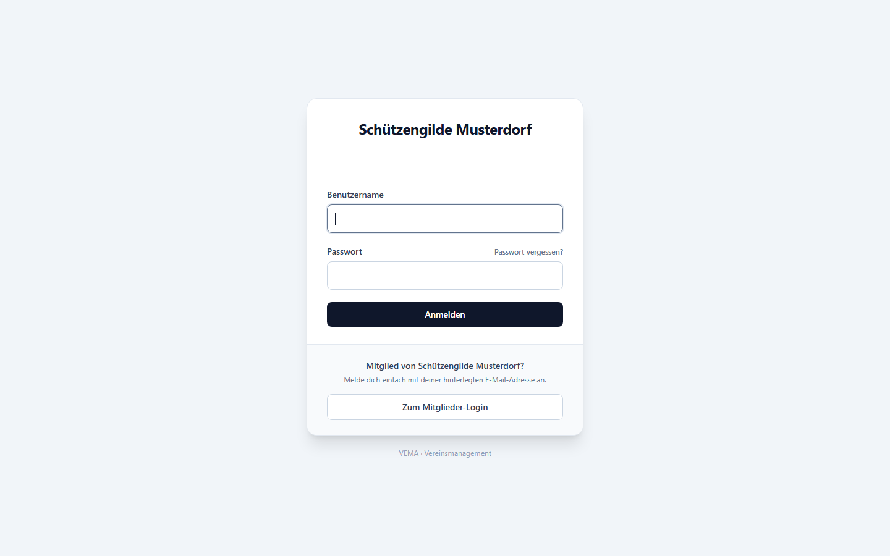

1. **Benutzername oder E-Mail-Adresse** eingeben. Teilen sich mehrere Zugänge dieselbe E-Mail-Adresse, wird der Zugang angemeldet, zu dem das Passwort passt.
2. **Passwort** eingeben.
3. Auf **Anmelden** klicken.

> **Sicherheit:** Nach 5 fehlgeschlagenen Versuchen wird die Anmeldung für diesen Benutzer für 5 Minuten gesperrt. Gesperrte Benutzer werden auch während einer laufenden Sitzung sofort abgemeldet.

Mitglieder, die keinen Funktionärszugang haben, gelangen über **Zum Mitglieder-Login** in den Mitgliederbereich (siehe Kapitel 13).

**Vereine auf vemat.at:** Jeder Verein hat eine eigene Adresse, z. B. `musikverein-musterdorf.vemat.at`. Wer die Adresse nicht mehr weiß, öffnet **app.vemat.at**, gibt unter **Zu deinem Verein** die Adresse (oder nur den ersten Teil, z. B. „musikverein-musterdorf“) ein und klickt **Zur Anmeldung**. Ist auch das vergessen, schickt **Adresse vergessen?** die Links aller Vereine an die hinterlegte Kontakt-E-Mail-Adresse. Der Benutzername des Admins, der den Verein registriert hat, ist seine **E-Mail-Adresse**.

### 2.2 Passwort vergessen

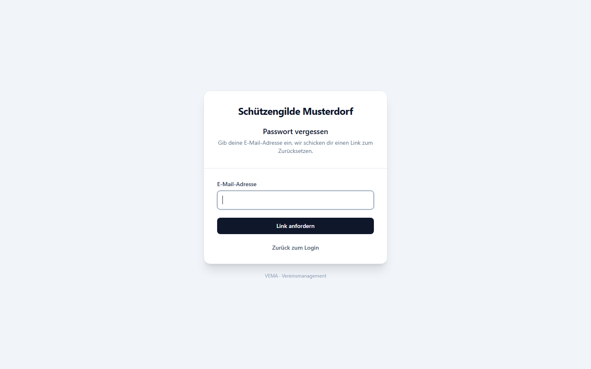

1. Auf der Anmeldeseite **Passwort vergessen?** anklicken.
2. Die hinterlegte **E-Mail-Adresse** eingeben und **Link anfordern** klicken.
3. Sie erhalten eine E-Mail mit einem Link. Dieser ist **60 Minuten** gültig.
4. Über den Link ein neues Passwort (mindestens 8 Zeichen) zweimal eingeben und **Passwort speichern**.

Aus Datenschutzgründen zeigt VEMA nie an, ob eine E-Mail-Adresse bekannt ist – die Bestätigungsmeldung erscheint immer.

### 2.3 Erstzugang

Neue Funktionäre werden vom Admin eingeladen (Kapitel 12.3). Sie erhalten eine **Willkommens-E-Mail** mit ihrem Benutzernamen, einem Link zum Festlegen des ersten Passworts (60 Minuten gültig) und einem Link zur Anmeldeseite. Ist der Link abgelaufen, hilft „Passwort vergessen?“ oder der Admin schickt mit **Link erneut senden** einen neuen.

### 2.4 Abmelden

Links unten in der Seitenleiste auf **Abmelden** klicken. An gemeinsam genutzten Computern sollten Sie sich immer abmelden.

---

## 3. Die Oberfläche im Überblick

- **Seitenleiste links:** Hauptmenü mit Dashboard, Mitglieder, Termine, Dienstplan, Mitgliedsbeiträge, Kassabuch, Rechnungen und der aufklappbaren Gruppe **Kommunikation** (Rundschreiben, Empfängergruppen, Fähigkeiten, Externe Kontakte, Templates). Der Punkt „Berichte“ ist ein Platzhalter für eine künftige Funktion.
- **Unten in der Seitenleiste:** Ihr Name und Benutzername, **📖 Anleitung** (dieses Handbuch), **Einstellungen** (nur Admin), ggf. **Testmodus starten** und **Abmelden**.
- **Kopfzeile:** Name der aktuellen Seite und das heutige Datum.
- **Meldungen:** Nach dem Speichern erscheinen grüne (Erfolg), gelbe (Warnung) oder rote (Fehler) Hinweise.
- **„Bitte warten …“:** Während VEMA Daten verarbeitet, wird kurz ein Ladehinweis eingeblendet.

> **Vereine auf vemat.at:** Menüpunkte für Funktionen, die nicht im gebuchten Paket enthalten sind, werden ausgeblendet. Während der Testphase sehen Admins oben auf jeder Seite einen Hinweis „Testphase mit allen Funktionen: noch … Tage“ (Kapitel 15.3).

### Am Smartphone

Auf kleinen Bildschirmen ist die Seitenleiste eingeklappt. Tippen Sie auf **☰** links oben, um das Menü zu öffnen. Tabellen werden am Handy als übersichtliche Karten dargestellt.

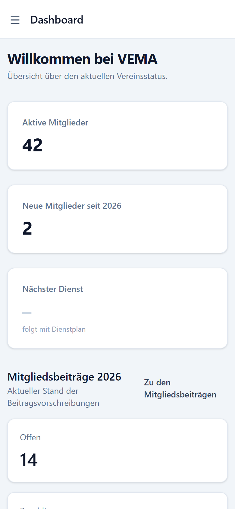

### Diese Anleitung

Über **📖 Anleitung** unten in der Seitenleiste öffnen Sie dieses Handbuch jederzeit in einem neuen Tab.

- **Inhaltsverzeichnis** links: Ein Klick springt zum Kapitel, das aktuell gelesene Kapitel ist hervorgehoben. Am Smartphone wählen Sie das Kapitel aus einer Liste.
- **Suche** oben rechts: Zeigt nur die Abschnitte, die den Suchbegriff enthalten, und markiert die Fundstellen gelb.
- **Abbildungen** lassen sich per Klick vergrößern; ein weiterer Klick oder die Taste Esc schließt die Ansicht.

---

## 4. Dashboard

Das Dashboard ist die Startseite nach dem Anmelden und zeigt den aktuellen Vereinsstatus auf einen Blick (siehe Abbildung in Kapitel 3):

- **Aktive Mitglieder** – Anzahl aller aktiven Mitglieder.
- **Neue Mitglieder seit {Jahr}** – Eintritte im laufenden Kalenderjahr.
- **Mitgliedsbeiträge {Jahr}** – Stand des aktuellsten Beitragsjahres: *Offen*, *Bezahlt*, *Befreit*, *Erinnerung fällig*, *Bereits erinnert*, dazu der offene und der bereits bezahlte Betrag. **Jede Kachel ist anklickbar** und öffnet die Beitragsliste mit dem passenden Filter.
- **Nächste Aktionen** – Direkter Sprung zu fälligen Erinnerungen und zu offenen Beiträgen von Mitgliedern **ohne E-Mail-Adresse** (für den Postversand).

---

## 5. Mitglieder

### 5.1 Mitgliederliste

Menü **Mitglieder** öffnet die Liste aller Mitglieder.

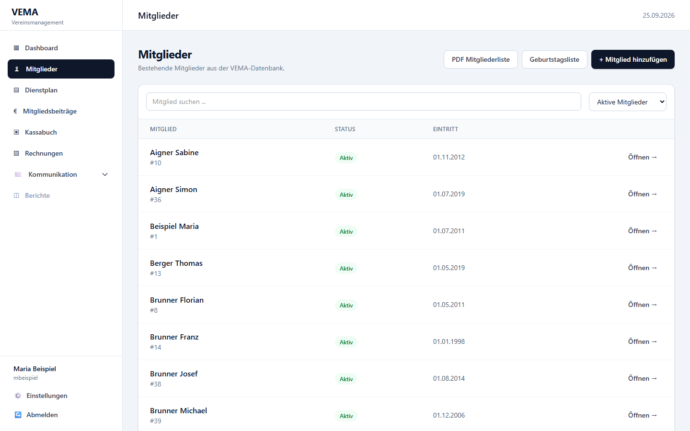

- **Suchfeld:** nach Vor- oder Nachname suchen – die Liste filtert beim Tippen.
- **Auswahlfeld rechts:** *Aktive Mitglieder* (Standard), *Inaktive Mitglieder* oder *Alle Mitglieder*.
- **Öffnen →** zeigt die Detailseite eines Mitglieds.
- **PDF Mitgliederliste** erstellt eine druckbare Übersicht.
- **Geburtstagsliste** öffnet die Geburtstagsübersicht (Kapitel 5.7).
- **+ Mitglied hinzufügen** legt ein neues Mitglied an.

### 5.2 Neues Mitglied anlegen

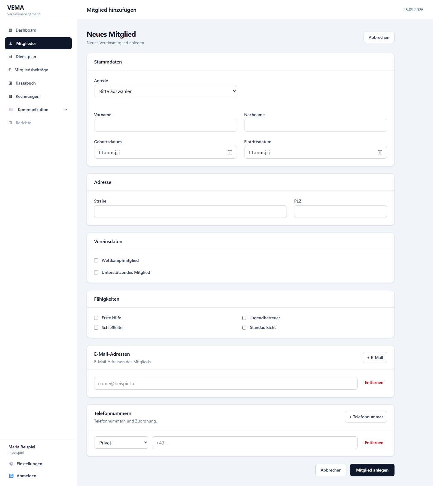

Das Formular ist in Abschnitte gegliedert:

| Abschnitt | Felder |
|---|---|
| **Stammdaten** | Anrede (Herr/Frau), Vorname, Nachname, Geburtsdatum, Eintrittsdatum |
| **Adresse** | Straße, PLZ – der **Ort wird automatisch** aus der Postleitzahl ermittelt |
| **Vereinsdaten** | Wettkampfmitglied, Unterstützendes Mitglied |
| **Fähigkeiten** | z. B. Standaufsicht, Erste Hilfe – wichtig für den Dienstplan |
| **E-Mail-Adressen** | beliebig viele über **+ E-Mail** |
| **Telefonnummern** | beliebig viele über **+ Telefonnummer**, mit Kategorie (Privat, Geschäftlich, Mutter, Vater, Oma, Opa, Sonstige) |

Pflichtfelder sind **Anrede, Vorname und Nachname**. Die **Adresse ist freiwillig** – Mitglieder ohne Adresse können ganz normal angelegt werden und erhalten Vorschreibungen und Erinnerungen trotzdem. Wird eine PLZ eingetragen, muss sie vierstellig sein (Eingaben wie „6300 Wörgl“ werden automatisch auf „6300“ gekürzt).

Mit **Mitglied anlegen** speichern.

**Willkommens-E-Mail:** Hat das neue Mitglied eine E-Mail-Adresse, ist unter den E-Mail-Adressen das Häkchen **Willkommens-E-Mail senden** gesetzt. Das Mitglied erhält dann eine Begrüßung mit Link zum Mitgliederbereich und – falls in den Einstellungen hinterlegt – einem Button zur WhatsApp-Community des Vereins (Kapitel 12.1). Beim Nacherfassen langjähriger Mitglieder das Häkchen einfach entfernen. Den Text passen Sie unter **Kommunikation → Templates** an (Vorlage „Willkommen – neues Mitglied“).

> **Wichtig:** Die **Anrede** kann nur beim Anlegen festgelegt werden – beim späteren Bearbeiten ist sie nicht mehr änderbar.

> **Tipp – Doppelte Mitglieder vermeiden:** Sobald Sie Vor- und Nachname eingeben, prüft VEMA, ob es bereits ein **ausgetretenes** Mitglied mit gleichem Namen gibt. In diesem Fall erscheint ein Hinweis mit Link zum bestehenden Mitglied. Erfassen Sie dort besser einen **Wiedereintritt**, damit die Vereinsgeschichte erhalten bleibt.

> **Vereine auf vemat.at:** Ist die Mitgliederzahl des Pakets erreicht, erscheint „Euer Paket … umfasst bis zu … aktive Mitglieder“ und es können keine weiteren aktiven Mitglieder angelegt werden (auch kein Wiedereintritt). Der Abschnitt **Fähigkeiten** erscheint nur in Paketen mit Dienstplan.

**Was beim Speichern automatisch passiert:**

- Die erste Mitgliedschaftsperiode beginnt mit dem Eintrittsdatum.
- Für alle offenen Beitragsjahre ab dem Eintrittsjahr wird ein offener Beitrag angelegt.

### 5.3 Mitglied ansehen

Die Detailseite zeigt alle Informationen zu einem Mitglied.

**Profilbild:** Links neben dem Namen steht das Profilbild – oder, solange keines hinterlegt ist, die Initialen. Ein Klick auf das Bild (kleines Kamera-Symbol) öffnet die Dateiauswahl (JPG, PNG oder WEBP). Danach legen Sie den Ausschnitt selbst fest: Bild verschieben, mit Mausrad, zwei Fingern oder **+ / −** zoomen, mit **↻** drehen, dann **Übernehmen**. VEMA speichert das Bild quadratisch in 400 × 400 Pixel; Ortsangaben und andere Metadaten aus Handyfotos werden dabei entfernt. **Entfernen** unter dem Bild löscht es wieder. Das Profilbild erscheint auch unten in der Seitenleiste, wenn Ihr Benutzerzugang mit einem Mitglied verknüpft ist.

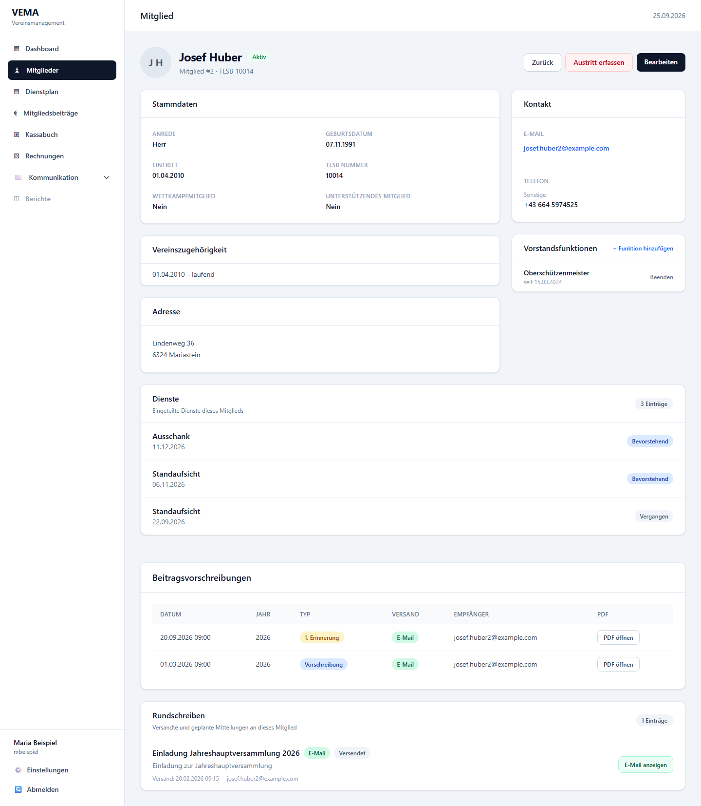

- **Stammdaten, Adresse, Kontakt** – E-Mail und Telefon sind direkt anklickbar.
- **Vereinszugehörigkeit** – alle Mitgliedschaftsperioden (z. B. „01.04.2010 – laufend“).
- **Vorstandsfunktionen** – aktuelle Funktionen mit Beginn (siehe 5.5).
- **Dienste** – eingeteilte Dienste mit Kennzeichnung *Bevorstehend* / *Vergangen*.
- **Beitragsvorschreibungen** – alle versendeten Vorschreibungen und Erinnerungen mit Datum, Versandart und **PDF öffnen**.
- **Dateien** – Dokumente des Mitglieds sowie alle Beitragsschreiben und Rundschreiben wie in einem Dateiexplorer (siehe 5.8).
- **Rundschreiben** – was das Mitglied erhalten hat; **E-Mail anzeigen** zeigt die versendete Nachricht.

Oben rechts: **Zurück**, **Austritt erfassen** (bzw. **Wiedereintritt erfassen** bei inaktiven Mitgliedern), **Willkommens-E-Mail senden** (bei aktiven Mitgliedern mit E-Mail-Adresse – z. B. wenn die erste E-Mail nicht angekommen ist) und **Bearbeiten**.

### 5.4 Austritt und Wiedereintritt

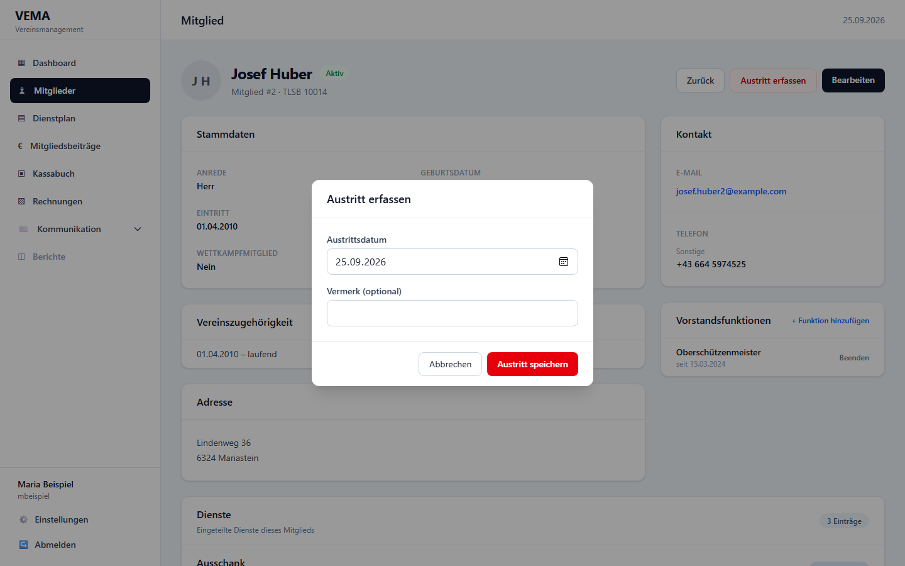

**Austritt:** Auf **Austritt erfassen** klicken, das **Austrittsdatum** wählen, optional einen **Vermerk** (z. B. „Austritt auf eigenen Wunsch“) eintragen und **Austritt speichern**. Das Mitglied wird inaktiv, bleibt aber mit seiner gesamten Geschichte erhalten.

**Wiedereintritt:** Bei einem inaktiven Mitglied auf **Wiedereintritt erfassen** klicken, Datum und optional Vermerk eintragen und speichern. Es beginnt eine neue Mitgliedschaftsperiode; fehlende Beiträge offener Beitragsjahre werden automatisch angelegt.

> Das Austrittsdatum darf nicht vor dem Eintritt liegen, das Wiedereintrittsdatum nicht vor dem letzten Austritt.

### 5.5 Vorstandsfunktionen

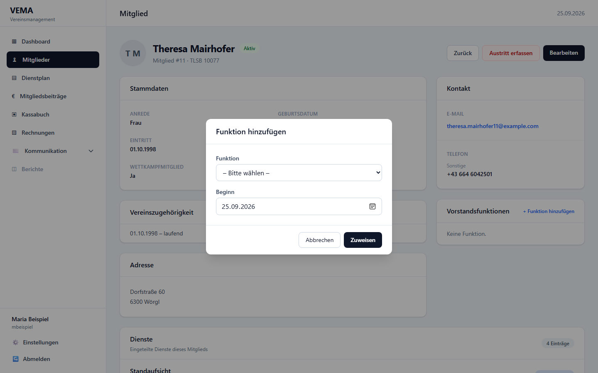

1. Auf der Detailseite im Kasten **Vorstandsfunktionen** auf **+ Funktion hinzufügen** klicken.
2. **Funktion** (z. B. Kassier) und **Beginn** wählen.
3. **Zuweisen** klicken.

Zum Beenden einer Funktion auf **Beenden** klicken, das Enddatum eintragen und **Bestätigen**.

> **Automatik Schützenrat:** Schriftführer und Kassier (inkl. Stellvertreter) gehören automatisch dem **Schützenrat** an – außer sie haben zusätzlich eine Spitzenfunktion (Oberschützenmeister, 1./2. Schützenmeister). Diese Einträge sind mit „(automatisch)“ gekennzeichnet und können nicht separat beendet werden.

### 5.6 Mitglied bearbeiten

Über **Bearbeiten** öffnet sich dasselbe Formular wie beim Anlegen (ohne Anrede). Entfernte E-Mail-Adressen oder Telefonnummern werden beim **Speichern** gelöscht.

### 5.7 Geburtstage

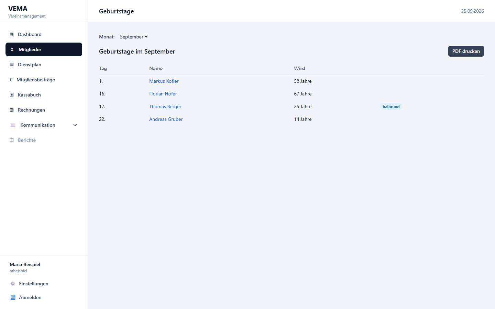

Über **Geburtstagsliste** sehen Sie alle Geburtstage aktiver Mitglieder im gewählten **Monat** mit dem Alter, das erreicht wird. Runde Geburtstage sind mit **🎉 rund**, halbrunde (25, 35, 45 …) mit **halbrund** markiert. **PDF drucken** erzeugt eine Liste zum Ausdrucken.

> Der Vorstand erhält runde und halbrunde Geburtstage zusätzlich automatisch per E-Mail (Kapitel 14). Welche Empfängergruppe diese E-Mails bekommt, stellt der Admin unter **Einstellungen → Briefpapier & E-Mail** ein (Standard: „Vorstand“). Die Empfänger stehen dabei im **BCC** – sie sehen die Adressen der anderen nicht.

### 5.8 Dateien zum Mitglied

*[Abbildung folgt: Dateien auf der Mitgliedsseite]*

Auf der Mitgliedsseite bündelt der Kasten **Dateien** alles, was zu einem Mitglied an Unterlagen gehört – wie in einem Dateiexplorer. Links stehen die Ordner, jeweils mit der Anzahl der enthaltenen Dateien; am Smartphone stehen sie als Leiste über der Liste:

| Ordner | Inhalt |
|---|---|
| **Alle** | alle Dateien der folgenden Ordner, neueste zuerst – diese Ansicht ist beim Öffnen gewählt; ein Etikett zeigt, aus welchem Ordner eine Datei stammt |
| **Dokumente** | selbst hochgeladene Unterlagen, z. B. Beitrittserklärung, Austrittserklärung, Vereinbarungen, Einverständnis- oder Datenschutzerklärungen |
| **Beitragsvorschreibungen** | alle versendeten Vorschreibungen und Erinnerungen (z. B. „Beitragsvorschreibung 2026“, „2. Erinnerung 2026“) mit Versandart |
| **Rundschreiben** | alle erhaltenen Rundschreiben als PDF sowie deren Anhänge als eigene Dateien |

Beitragsschreiben und Rundschreiben erscheinen hier automatisch, sobald sie versendet wurden – sie müssen nicht hochgeladen werden. Die bisherigen Abschnitte **Beitragsvorschreibungen** und **Rundschreiben** weiter unten auf der Mitgliedsseite bleiben unverändert.

#### Ansicht, Suche und Vorschau

- Oben rechts wechseln Sie zwischen **Liste** (mit Datum, Kategorie, Größe und Notiz) und **Kacheln** (Bilder als Vorschaubild).
- Das **Suchfeld** durchsucht den geöffneten Ordner nach Name, Kategorie und Notiz – im Ordner **Alle** also sämtliche Dateien.
- Ein Klick auf eine Datei öffnet die **Vorschau**: PDFs und Bilder werden direkt auf der Seite angezeigt, mit **Herunterladen** und **In neuem Tab**. Word-, Excel- und HEIC-Dateien (iPhone-Fotos) lassen sich nicht in der Vorschau anzeigen, sondern nur herunterladen.
- Beim Herunterladen trägt die Datei ihren Namen aus VEMA (samt ursprünglicher Endung, z. B. „.pdf“).

#### Dokumente hochladen

1. In der Ansicht **Alle** oder im Ordner **Dokumente** die Dateien in das gestrichelte Feld ziehen – oder auf **auswählen** klicken. Mehrere Dateien auf einmal sind möglich, ebenso mehrere Auswahlen nacheinander (z. B. am Smartphone Foto für Foto).
   - Erlaubt sind **PDF**, Bilder (**JPG, PNG, WEBP, HEIC**), **Word** (DOC, DOCX, ODT), **Excel** (XLS, XLSX, ODS) und **Text** (TXT), jeweils höchstens **10 MB**. Andere Dateien werden mit einem Hinweis abgelehnt.
2. Die gewählten Dateien erscheinen in einer Liste. Mit **Entfernen** nehmen Sie eine versehentlich gewählte Datei wieder heraus – gespeichert ist noch nichts.
3. Optional eine **Kategorie** eintragen, z. B. „Beitrittserklärung“. Die Kategorie ist frei wählbar; bereits verwendete Kategorien werden beim Tippen vorgeschlagen, damit die Schreibweise einheitlich bleibt.
4. Optional eine **Notiz** eintragen, z. B. „Original im Vereinsordner“.
5. Bei Bedarf **Im Mitgliederbereich für das Mitglied sichtbar** anhaken (Standard: aus).
6. Auf **Datei speichern** bzw. **… Dateien speichern** klicken.

Kategorie, Notiz und Freigabe gelten für alle Dateien dieses Speichervorgangs. Sollen Dateien unterschiedliche Kategorien bekommen, laden Sie sie einzeln hoch oder ändern Sie die Angaben anschließend über **Bearbeiten**. Hochgeladene Dokumente landen immer im Ordner **Dokumente** und stehen in **Alle** ganz oben.

#### Dokumente bearbeiten, freigeben und löschen

- **Bearbeiten** öffnet ein Fenster, in dem Sie **Name**, **Kategorie**, **Notiz** und die Freigabe **Im Mitgliederbereich für das Mitglied sichtbar** ändern. Mit **Speichern** übernehmen.
- Freigegebene Dokumente sind in der Liste mit **im Mitgliederbereich** bzw. in der Kachelansicht mit **● sichtbar** markiert.
- **Löschen** (in der Liste oder im Bearbeiten-Fenster) entfernt das Dokument nach einer Rückfrage **endgültig** – auch für das Mitglied.
- Beitragsschreiben und Rundschreiben lassen sich hier nicht bearbeiten oder löschen; sie gehören zum jeweiligen Versand.

Hochladen, Ändern und Löschen werden im **Aktivitätsprotokoll** festgehalten (Bereich „Mitglieder“), bei Änderungen mit vorher → nachher.

> **Datenschutz:** Dokumente sehen alle Funktionäre mit Zugang zu den Mitgliedern. Das Mitglied selbst sieht nur Dokumente, die ausdrücklich für den Mitgliederbereich freigegeben sind (Kapitel 13.8). Die Dateien liegen geschützt in VEMA und sind nur nach Anmeldung abrufbar – Links funktionieren für Außenstehende nicht.

> **Testmodus:** Im Testmodus hochgeladene oder gelöschte Dateien betreffen nur die Testdaten, nicht die echten Unterlagen.

---

## 6. Dienstplan

Mit dem Dienstplan organisieren Sie wiederkehrende Dienste wie Standaufsicht oder Ausschank. VEMA erzeugt die Termine und teilt die Helfer auf Wunsch automatisch und fair ein. Einzelne Vereinstermine wie Sitzungen oder Feste verwalten Sie dagegen unter **Termine** (Kapitel 7).

### 6.1 Überblick und Ablauf

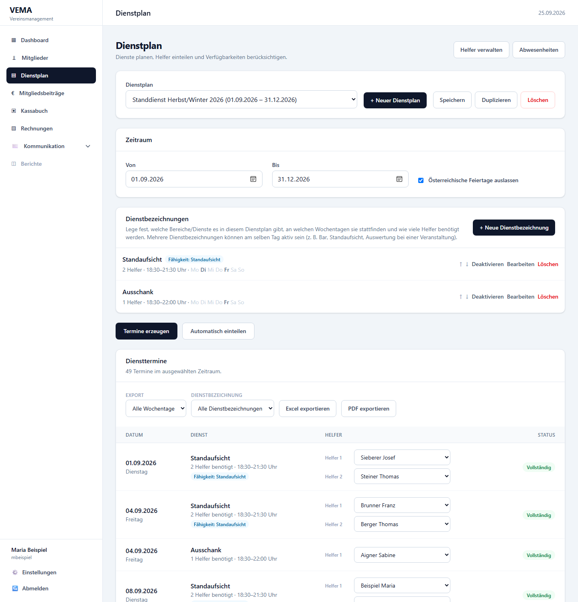

Der typische Ablauf in fünf Schritten:

1. **Dienstplan anlegen** (z. B. „Standdienst Herbst/Winter 2026“) mit Zeitraum.
2. **Dienstbezeichnungen** festlegen – welche Dienste an welchen Wochentagen mit wie vielen Helfern.
3. **Helfer verwalten** – wer bei diesem Plan mithilft und an welchen Wochentagen.
4. **Termine erzeugen** – VEMA legt alle Einzeltermine im Zeitraum an.
5. **Automatisch einteilen** – oder die Helfer manuell auswählen.

### 6.2 Dienstplan anlegen und verwalten

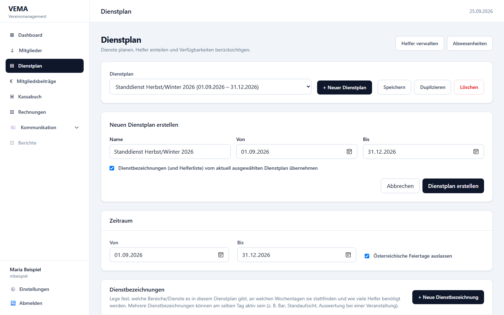

- **+ Neuer Dienstplan:** Name, Von, Bis eingeben. Ist das Häkchen „Dienstbezeichnungen (und Helferliste) vom aktuell ausgewählten Dienstplan übernehmen“ gesetzt, müssen Sie diese nicht neu erfassen. Mit **Dienstplan erstellen** abschließen.
- **Auswahlfeld „Dienstplan“:** zwischen mehreren Plänen wechseln.
- **Speichern:** Änderungen an Name, Zeitraum und Feiertagsregel sichern.
- **Duplizieren:** erstellt eine Kopie („… Kopie“) mit Dienstbezeichnungen und Helferliste, aber ohne Termine.
- **Löschen:** entfernt den Plan inklusive aller Termine und Einteilungen.
- **Österreichische Feiertage auslassen:** An gesetzlichen Feiertagen (inkl. Ostermontag, Christi Himmelfahrt, Pfingstmontag, Fronleichnam) werden keine Termine erzeugt.

### 6.3 Dienstbezeichnungen

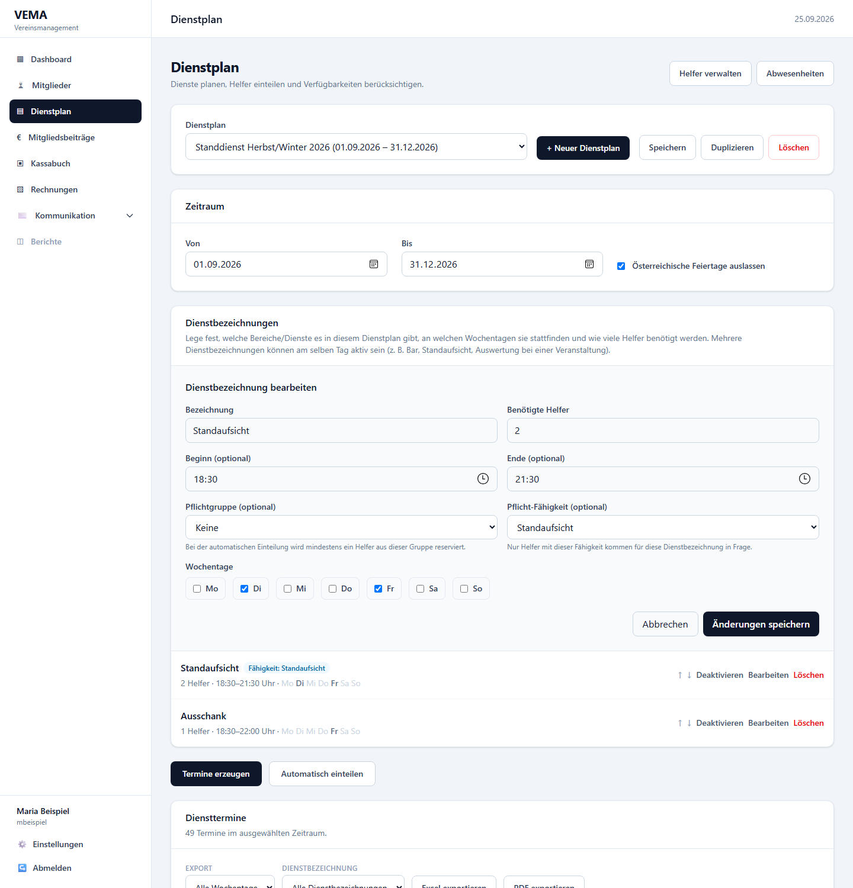

Über **+ Neue Dienstbezeichnung** bzw. **Bearbeiten** legen Sie fest:

| Feld | Bedeutung |
|---|---|
| **Bezeichnung** | z. B. Standaufsicht, Ausschank |
| **Benötigte Helfer** | 1 bis 20 Personen pro Termin |
| **Beginn / Ende** | optionale Uhrzeiten (erscheinen auch im Kalender) |
| **Pflichtgruppe** | optional: mindestens *n* Helfer müssen aus einer Empfängergruppe kommen (z. B. mindestens 1 aus „Vorstand“) |
| **Pflicht-Fähigkeit** | optional: nur Helfer mit dieser Fähigkeit werden eingeteilt |
| **Wochentage** | an welchen Tagen der Dienst stattfindet |

In der Liste können Sie die Reihenfolge mit **↑ ↓** ändern, einen Dienst **Deaktivieren** (bleibt erhalten, erzeugt aber keine neuen Termine) oder **Löschen**. Löschen ist nicht möglich, wenn bereits Helfer eingeteilt sind – dann bitte deaktivieren.

### 6.4 Helfer verwalten

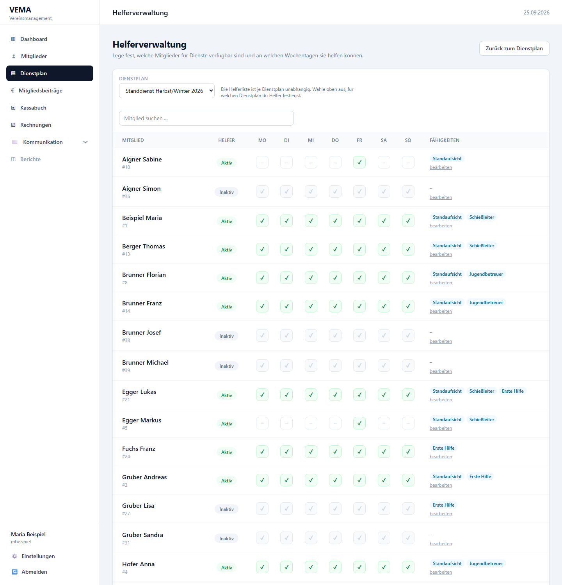

Über **Helfer verwalten** legen Sie für **jeden Dienstplan eigens** fest, wer mithilft:

- Mit dem Knopf **Aktiv/Inaktiv** nehmen Sie ein Mitglied in die Helferliste auf (zunächst mit allen Wochentagen).
- Mit **✓ / –** bei **Mo … So** stellen Sie ein, an welchen Wochentagen jemand verfügbar ist.
- Die Spalte **Fähigkeiten** zeigt, welche Dienste die Person übernehmen darf.
- **Helfer von anderem Plan übernehmen** kopiert die Helferliste eines anderen Plans.
- Im Abschnitt **Externe Helfer** können auch Personen ohne Mitgliedschaft (aus den externen Kontakten) eingeteilt werden.

### 6.5 Abwesenheiten

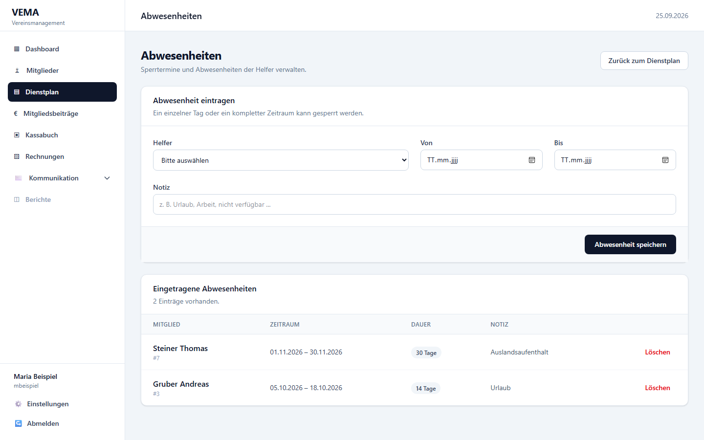

Unter **Abwesenheiten** tragen Sie Urlaube oder sonstige Verhinderungen ein: **Helfer**, **Von**, **Bis** und optional eine **Notiz**, dann **Abwesenheit speichern**. Abwesende Helfer werden weder automatisch noch manuell für Termine in diesem Zeitraum vorgeschlagen.

### 6.6 Termine erzeugen und Helfer einteilen

**Termine erzeugen** legt für jeden Tag im Zeitraum und jede passende Dienstbezeichnung einen Termin an. Bereits vorhandene Termine werden aktualisiert. Termine, die nicht mehr passen, werden nur entfernt, wenn noch niemand eingeteilt ist – sonst weist VEMA darauf hin.

**Automatisch einteilen** verteilt die Helfer fair:

- Es werden nur Helfer der Helferliste berücksichtigt, die an dem Wochentag verfügbar und nicht abwesend sind.
- Pflicht-Fähigkeiten und Pflichtgruppen werden beachtet.
- Niemand wird am selben Tag für zwei Dienste eingeteilt.
- Wer bisher weniger Dienste hatte oder länger keinen Dienst hatte, kommt zuerst dran. Dienste an kurz aufeinanderfolgenden Tagen (innerhalb von 4 Tagen) werden vermieden, ebenso immer dieselben Teams.

> **Achtung:** „Automatisch einteilen“ **ersetzt alle bestehenden Einteilungen** im gewählten Zeitraum. Wenn Sie nur einzelne Termine ändern möchten, tun Sie das manuell.

**Manuell einteilen:** In der Tabelle **Diensttermine** wählen Sie pro Termin bei **Helfer 1, Helfer 2 …** eine Person aus. Es werden nur passende und verfügbare Helfer angeboten. Der **Status** zeigt *Vollständig*, *Teilweise* oder *Offen*.

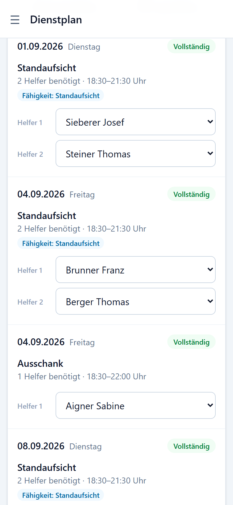

### 6.7 Export

Über **Excel exportieren** oder **PDF exportieren** erhalten Sie den Dienstplan zum Aushängen oder Weitergeben. Mit den Filtern **Export** (Wochentag) und **Dienstbezeichnung** lässt sich der Export einschränken – z. B. nur alle Freitage oder nur den Ausschank.

---

## 7. Termine

Unter **Termine** planen Sie einzelne Vereinstermine wie Sitzungen, die Jahreshauptversammlung, Feste oder Ausrückungen. Mitglieder sehen die Termine im Mitgliederbereich, können zu- oder absagen und haben sie automatisch in ihrem Kalender-Abo. Zusätzlich lassen sich **externe Kalender** (z. B. vom Verband oder der Gemeinde) einbinden, deren Termine VEMA selbstständig übernimmt.

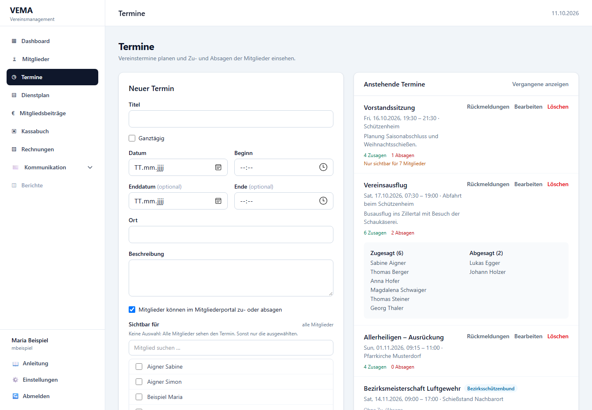

### 7.1 Termin anlegen

Links auf der Seite steht das Formular **Neuer Termin**:

| Feld | Bedeutung |
|---|---|
| **Titel** | z. B. „Jahreshauptversammlung“ (Pflichtfeld) |
| **Ganztägig** | Häkchen für Termine ohne Uhrzeit, z. B. ein Fest über zwei Tage – die Uhrzeitfelder verschwinden dann |
| **Datum** / **Beginn** | Tag und Uhrzeit des Beginns (Pflichtfelder; Beginn entfällt bei ganztägigen Terminen) |
| **Enddatum** / **Ende** | optional – für mehrtägige Termine bzw. die Uhrzeit des Endes |
| **Ort** | z. B. „Gasthof Post“ |
| **Beschreibung** | weitere Informationen für die Mitglieder |
| **Mitglieder können im Mitgliederportal zu- oder absagen** | standardmäßig an; abschalten für reine Informationstermine |
| **Sichtbar für** | Wer den Termin sieht – siehe unten |

Mit **Termin anlegen** speichern.

**Sichtbar für:** Ist **kein Mitglied ausgewählt**, sehen **alle Mitglieder** den Termin. Hakt man Mitglieder an, sehen **nur diese** den Termin im Mitgliederbereich und in ihrem Kalender-Abo – praktisch z. B. für Vorstandssitzungen. Über **Mitglied suchen …** filtern Sie die Liste; rechts oben steht, wie viele ausgewählt sind („alle Mitglieder“ bzw. „3 ausgewählt“).

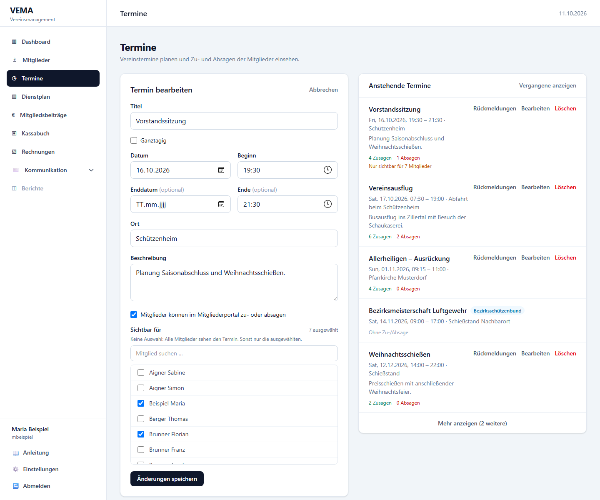

### 7.2 Terminliste

Rechts sehen Sie die **Anstehenden Termine** – zunächst die nächsten fünf, mit **Mehr anzeigen** jeweils fünf weitere. Über **Vergangene anzeigen** wechseln Sie zu den vergangenen Terminen.

Zu jedem Termin werden angezeigt:

- Datum, Uhrzeit, Ort und Beschreibung,
- die Zahl der **Zusagen** und **Absagen** (bzw. „Ohne Zu-/Absage“),
- bei eingeschränkten Terminen „**Nur sichtbar für … Mitglieder**“ – mit der Maus darauf zeigen, um die Namen zu sehen,
- bei Terminen aus externen Kalendern ein farbiges Etikett mit dem Namen des Kalenders.

Mit **Bearbeiten** ändern Sie einen Termin (auch die Auswahl „Sichtbar für“ – alle Häkchen entfernen macht ihn wieder für alle sichtbar). **Löschen** entfernt den Termin samt allen Rückmeldungen.

### 7.3 Zu- und Absagen einsehen

Ein Klick auf **Rückmeldungen** klappt beim Termin zwei Spalten auf: **Zugesagt** und **Abgesagt**, jeweils mit Anzahl und Namen. Mitglieder melden sich im Mitgliederbereich zurück und können ihre Antwort bis zum Termin jederzeit ändern (Kapitel 13.6).

> Zu- und Absagen werden nur in VEMA gespeichert. Bei Terminen aus externen Kalendern wird nichts an den ursprünglichen Kalender zurückgemeldet.

### 7.4 Externe Kalender einbinden

Im Abschnitt **Externe Kalender** unten auf der Seite binden Sie Kalender ein, die als **iCal-Link** veröffentlicht sind – etwa den Terminkalender des Landesverbands, der Gemeinde oder einen Google-Kalender des Vorstands.

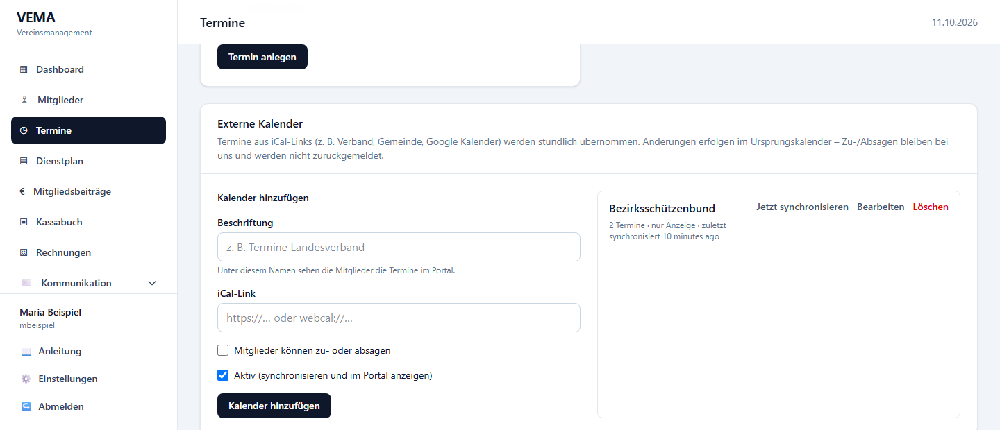

1. Unter **Kalender hinzufügen** eine **Beschriftung** eingeben, z. B. „Termine Landesverband“. Unter diesem Namen sehen die Mitglieder die Termine – wählen Sie also einen Namen, mit dem sie etwas anfangen können.
2. Den **iCal-Link** einfügen (beginnt mit `https://` oder `webcal://`).
3. Optional **Mitglieder können zu- oder absagen** anhaken.
4. **Aktiv (synchronisieren und im Portal anzeigen)** ist vorbelegt.
5. **Kalender hinzufügen** – VEMA liest den Kalender sofort ein.

> **Wo finde ich den iCal-Link?** In Google Kalender in den Einstellungen des jeweiligen Kalenders unter „Kalender integrieren“ („Öffentliche Adresse im iCal-Format“ oder „Geheime Adresse im iCal-Format“). In Outlook über „Kalender freigeben/veröffentlichen“ → ICS-Link. Viele Verbände veröffentlichen den Link direkt auf ihrer Website.

**So funktioniert die Übernahme:**

- VEMA gleicht alle externen Kalender **stündlich** automatisch ab. Mit **Jetzt synchronisieren** geht es sofort.
- Übernommen werden Termine von einem Monat zurück bis ein Jahr im Voraus. **Serientermine** (z. B. wöchentliches Training) erscheinen als einzelne Termine.
- Änderungen im Ursprungskalender (Zeit, Ort, Titel) werden übernommen; Zu- und Absagen bleiben dabei erhalten. Termine, die dort gelöscht oder abgesagt werden, verschwinden auch in VEMA.
- Übernommene Termine können in VEMA **nicht bearbeitet oder gelöscht** werden – Änderungen bitte im Ursprungskalender vornehmen.
- Die Auswahl „Sichtbar für“ gibt es nur bei eigenen Terminen; Termine externer Kalender sehen alle Mitglieder.

In der Liste der Kalender sehen Sie, wie viele Termine übernommen wurden, ob Zu-/Absagen möglich sind und wann zuletzt synchronisiert wurde. Ist ein Kalender nicht erreichbar oder der Link ungültig, steht der Grund **rot** darunter – bereits übernommene Termine bleiben dann unverändert.

- **Bearbeiten:** Beschriftung, Link und Einstellungen ändern. Wird „Mitglieder können zu- oder absagen“ umgestellt, gilt das sofort für alle Termine dieses Kalenders.
- **Aktiv** abschalten: Der Kalender wird nicht mehr abgeglichen und seine Termine sind im Mitgliederbereich ausgeblendet.
- **Löschen:** entfernt den Kalender samt allen übernommenen Terminen und Rückmeldungen.

> **Sicherheit:** Der iCal-Link wird verschlüsselt gespeichert, weil private Kalender-Links ein Geheimnis enthalten. Links auf interne Adressen (z. B. im eigenen Netzwerk) werden aus Sicherheitsgründen abgelehnt.

---

## 8. Mitgliedsbeiträge

### 8.1 Überblick

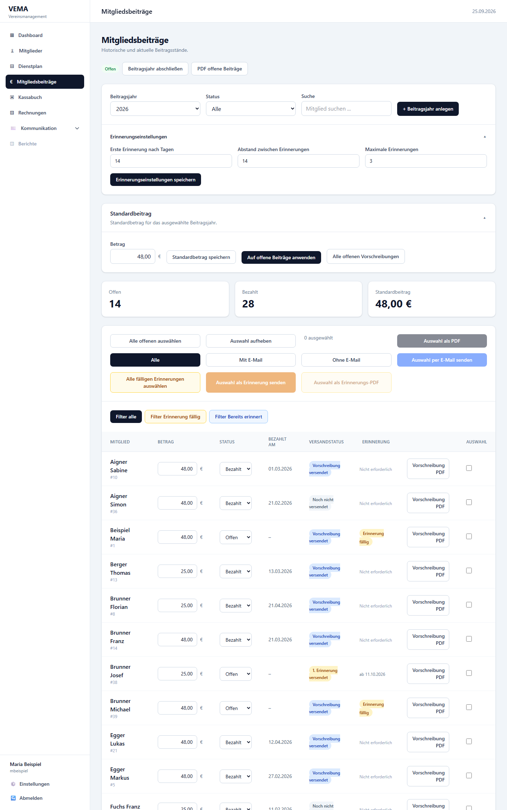

Die Seite zeigt alle Beiträge des gewählten **Beitragsjahres**. Oben filtern Sie nach **Status** (Alle, Offen, Bezahlt, Befreit) oder suchen nach einem Mitglied.

Die Tabelle enthält pro Mitglied:

| Spalte | Bedeutung |
|---|---|
| **Betrag** | direkt änderbar (z. B. für ermäßigte Beiträge) |
| **Status** | *Offen*, *Bezahlt* (setzt das Zahlungsdatum auf heute) oder *Befreit* |
| **Bezahlt am** | Datum des Zahlungseingangs |
| **Versandstatus** | *Noch nicht versendet*, *Vorschreibung versendet* oder *n. Erinnerung versendet* |
| **Erinnerung** | *Nicht erforderlich*, *Vorschreibung fehlt*, *Erinnerung fällig*, *ab TT.MM.JJJJ* oder *Max. Erinnerungen erreicht* |
| **Vorschreibung PDF** | das Schreiben als PDF |
| **Auswahl** | Häkchen für den Sammelversand |

### 8.2 Neues Beitragsjahr anlegen

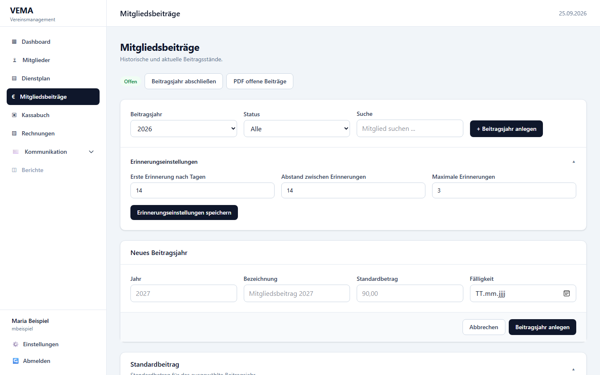

1. **+ Beitragsjahr anlegen** klicken.
2. **Jahr**, **Bezeichnung** (z. B. „Mitgliedsbeitrag 2027“), **Standardbetrag** und optional die **Fälligkeit** eingeben.
3. **Beitragsjahr anlegen** klicken.

Für **jedes aktive Mitglied** wird automatisch ein offener Beitrag mit dem Standardbetrag angelegt. Später eintretende Mitglieder erhalten ihren Beitrag automatisch dazu.

Gibt es noch gar kein Beitragsjahr (z. B. bei einem neu eingerichteten Verein), zeigt die Seite „Noch kein Beitragsjahr angelegt“ – legen Sie dann wie oben beschrieben das erste an.

> **Tipp:** Die **Fälligkeit** unbedingt eintragen – ohne Fälligkeitsdatum kann VEMA keine Erinnerungen berechnen.

### 8.3 Standardbetrag und Erinnerungseinstellungen

- **Standardbeitrag:** Betrag ändern und **Standardbetrag speichern**. Mit **Auf offene Beiträge anwenden** wird der neue Betrag für alle noch offenen Beiträge übernommen.
- **Erinnerungseinstellungen** (je Beitragsjahr):
  - *Erste Erinnerung nach Tagen* – Tage nach der Fälligkeit bis zur ersten Erinnerung
  - *Abstand zwischen Erinnerungen* – Tage zwischen weiteren Erinnerungen
  - *Maximale Erinnerungen* – danach wird nicht mehr erinnert

### 8.4 Vorschreibungen versenden

1. Mit **Alle offenen auswählen** alle offenen Beiträge markieren – oder einzelne Häkchen setzen.
2. Mit **Mit E-Mail** / **Ohne E-Mail** eingrenzen, wer wie erreicht wird.
3. Versand wählen:
   - **Auswahl per E-Mail senden** – jedes Mitglied erhält ein persönliches PDF auf Vereinsbriefpapier per E-Mail.
   - **Auswahl als PDF** – ein Sammel-PDF für alle ausgewählten Mitglieder zum Ausdrucken und Versenden per Post.

Alle versendeten Schreiben werden beim Mitglied gespeichert und sind dort und im Mitgliederbereich jederzeit abrufbar.

> **Hinweis:** Hat ein Mitglied bereits eine Vorschreibung erhalten, hält der Versand dort an und fragt nach: **Trotzdem erneut senden**, **Als Erinnerung senden** oder **Abbrechen**. Die danach folgenden Mitglieder werden in diesem Durchgang noch nicht versendet – starten Sie den Versand anschließend erneut.

Der Text der Schreiben wird unter **Kommunikation → Templates** gepflegt (Kapitel 9.5), Briefpapier, Ort in der Datumszeile und Unterschriften unter **Einstellungen → Briefpapier & E-Mail** (Kapitel 12.2).

### 8.5 Erinnerungen (Mahnungen)

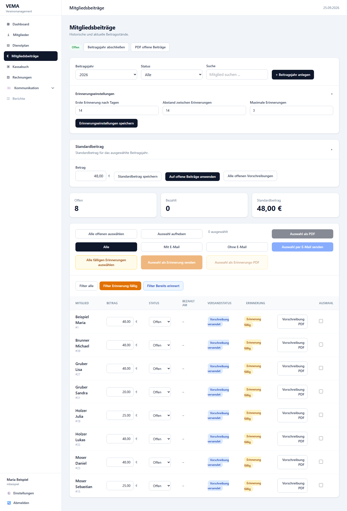

Eine Erinnerung ist **fällig**, wenn

- der Beitrag noch offen ist,
- bereits eine Vorschreibung versendet wurde,
- die maximale Zahl an Erinnerungen noch nicht erreicht ist und
- die in den Erinnerungseinstellungen festgelegte Frist abgelaufen ist.

So versenden Sie Erinnerungen:

1. **Filter Erinnerung fällig** oder direkt **Alle fälligen Erinnerungen auswählen**.
2. **Auswahl als Erinnerung senden** → im Dialog **Erinnerungen jetzt senden** bestätigen. Die Stufe (1., 2., … Erinnerung) wird automatisch hochgezählt.
3. Für Mitglieder ohne E-Mail: **Auswahl als Erinnerungs-PDF** für den Postversand.

### 8.6 Zahlungen erfassen

Wenn ein Beitrag eingeht, stellen Sie in der Spalte **Status** auf **Bezahlt**. Das Zahlungsdatum wird automatisch gesetzt. Am Smartphone gibt es dafür die Knöpfe **✓ Bezahlt**, **Befreien** und **Zurück auf offen**.

### 8.7 Beitragsjahr abschließen

Mit **Beitragsjahr abschließen** wird ein Jahr gesperrt – Beträge und Status können dann nicht mehr verändert werden. Über **Beitragsjahr wieder öffnen** lässt sich das rückgängig machen. **PDF offene Beiträge** liefert eine Liste aller noch offenen Beiträge.

---

## 9. Kommunikation

### 9.1 Rundschreiben

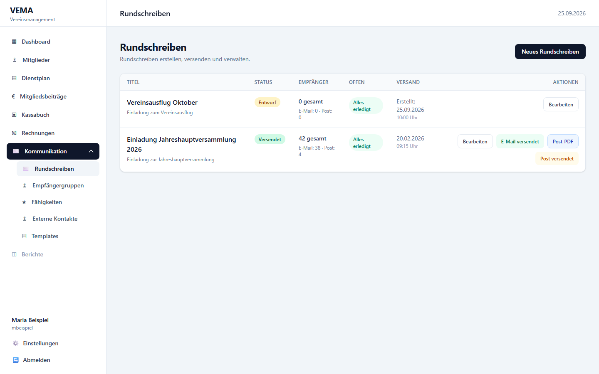

Die Übersicht zeigt alle Rundschreiben mit Status (*Entwurf* / *Versendet*), Anzahl der Empfänger (aufgeteilt in E-Mail und Post) und ob noch Empfänger offen sind.

**Neues Rundschreiben erstellen:**

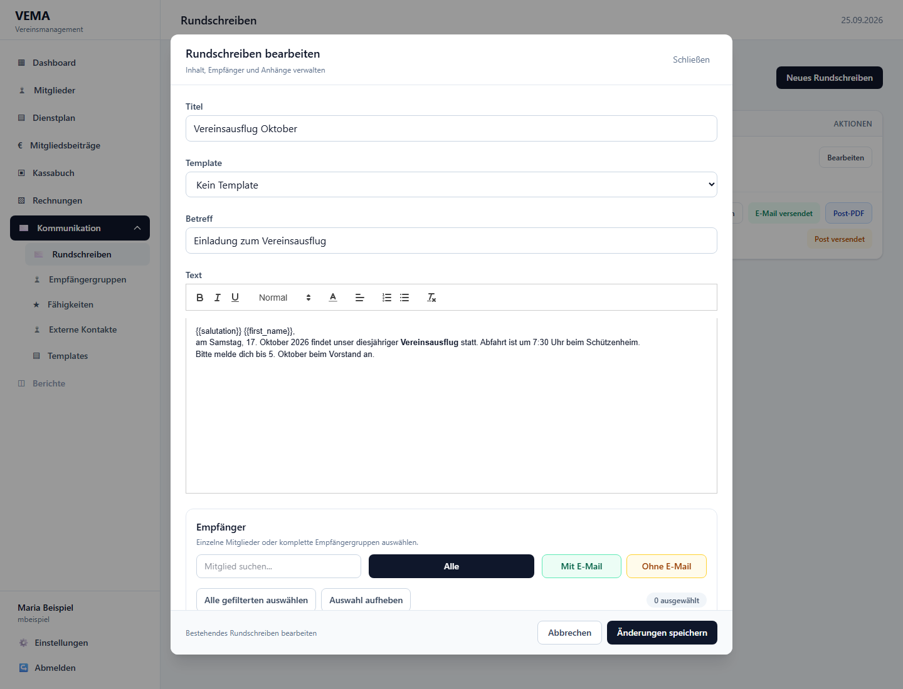

1. **Neues Rundschreiben** klicken.
2. **Titel** (interne Bezeichnung) eingeben, optional ein **Template** wählen, **Betreff** und **Text** verfassen. Platzhalter wie `{{salutation}}` und `{{first_name}}` werden für jeden Empfänger persönlich ersetzt.
3. **Empfänger** auswählen:
   - einzeln per Häkchen oder über die Suche,
   - mit **Alle gefilterten auswählen** (kombinierbar mit *Mit E-Mail* / *Ohne E-Mail*),
   - oder über die Knöpfe der **Empfängergruppen** (z. B. „Vorstand (7)“).
4. Optional **Anhänge** hinzufügen (PDF, Word, Excel, JPG, PNG – je max. 10 MB).
5. **Entwurf anlegen** klicken.

**Versandart:** Mitglieder mit E-Mail-Adresse erhalten das Rundschreiben per **E-Mail**, Mitglieder ohne E-Mail werden für den **Postversand** vorgemerkt. Externe Kontakte erhalten es immer per E-Mail. Jeder Empfänger bekommt eine **eigene E-Mail** – niemand sieht die Adressen der anderen.

**Gemeinsame E-Mail-Adresse (z. B. Familien):** Haben mehrere Empfänger dieselbe E-Mail-Adresse, kommt dort nur **eine** E-Mail an, in der jede Person angesprochen wird – aus `{{salutation}} {{first_name}}` wird z. B. „Liebe Anna, lieber Max und liebe Lisa“. Als versendet gilt das Rundschreiben trotzdem für jedes Mitglied einzeln, es erscheint also auch bei jedem im Mitgliederbereich und auf der Mitgliedsseite. Die **Testmail** geht weiterhin nur an die gewählte Person. Briefe per Post werden nicht zusammengefasst.

**Versenden** (Knöpfe in der Spalte *Aktionen*):

- **E-Mail versenden** – verschickt an alle noch offenen E-Mail-Empfänger.
- **Post-PDF** – ein Sammel-PDF aller Briefe auf Vereinsbriefpapier zum Ausdrucken.
- **Post erledigt** – markiert alle Post-Empfänger als versendet, nachdem die Briefe abgeschickt wurden.

> **Achtung:** Wird ein Rundschreiben nachträglich bearbeitet und gespeichert, wird die Empfängerliste neu aufgebaut – der Versandstatus der einzelnen Empfänger geht dabei verloren. Bearbeiten Sie versendete Rundschreiben daher nur, wenn es wirklich nötig ist.

### 9.2 Empfängergruppen

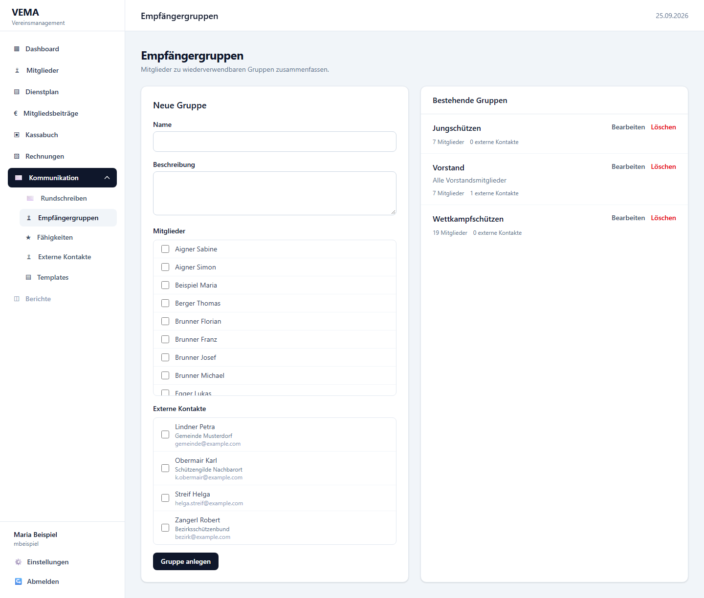

Gruppen fassen Mitglieder und externe Kontakte zusammen, z. B. „Vorstand“, „Jungschützen“ oder „Wettkampfschützen“. Name und Beschreibung eingeben, Mitglieder/Kontakte anhaken und **Gruppe anlegen**.

Gruppen werden verwendet für:

- die schnelle Empfängerauswahl bei Rundschreiben,
- **Pflichtgruppen** im Dienstplan,
- die automatischen **Geburtstags-E-Mails**: Diese gehen an die Gruppe, die unter **Einstellungen → Briefpapier & E-Mail** gewählt ist – standardmäßig die Gruppe mit dem Namen **„Vorstand“**. Wenn Sie diese Gruppe umbenennen, wählen Sie sie dort neu aus.

### 9.3 Externe Kontakte

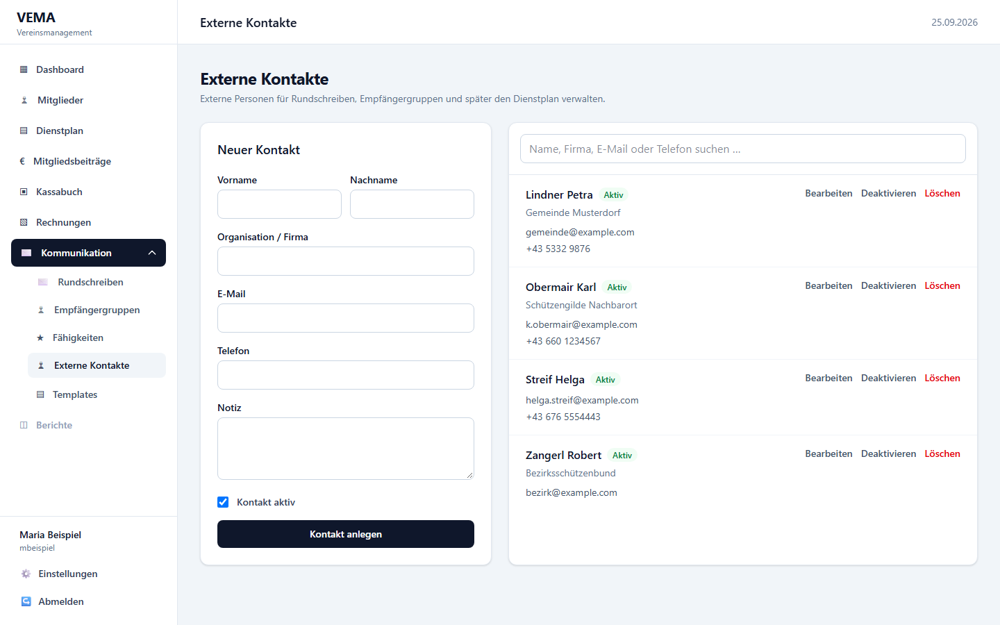

Externe Kontakte sind Personen ohne Mitgliedschaft – z. B. Gemeinde, Nachbarvereine oder Helfer von außen. Pflicht sind **Vorname, Nachname und E-Mail**. Kontakte können Empfängergruppen angehören, Rundschreiben erhalten und als externe Helfer im Dienstplan eingeteilt werden. Mit **Deaktivieren** blenden Sie Kontakte aus, ohne sie zu löschen.

**Kontakte aus Excel oder CSV importieren**

Viele Kontakte auf einmal – z. B. eine Liste aller Nachbarvereine – übernehmen Sie über **Kontakte importieren** rechts oben.

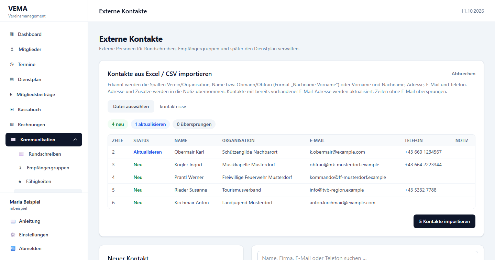

1. Eine Datei auswählen: **Excel (.xlsx, .xls) oder CSV**, höchstens 5 MB. Gelesen wird das erste Tabellenblatt.
2. VEMA sucht in den ersten 20 Zeilen die **Kopfzeile** und erkennt die Spalten anhand ihrer Überschrift:

   | Spalte | erkannte Überschriften (Auszug) |
   |---|---|
   | Name | „Name“, „Obmann“, „Obfrau“, „Ansprechpartner“, „Kontakt“ – im Format „Nachname Vorname“ – oder getrennt „Vorname“ und „Nachname“ |
   | E-Mail | alles mit „Mail“ |
   | Telefon | „Telefon“, „Handy“, „Mobil“, „Tel“ |
   | Organisation | „Verein“, „Organisation“, „Firma“, „Körperschaft“, „Institution“ |
   | Adresse | „Adresse“, „Anschrift“, „Straße“ |

   Pflicht sind eine **Namens-** und eine **E-Mail-Spalte**. Adresse, weitere E-Mail-Adressen, weitere Personen und nicht erkannte Spalten landen in der **Notiz** des Kontakts.
3. Es erscheint eine **Vorschau** mit allen Zeilen und dem Ergebnis je Zeile: *Neu*, *Aktualisieren* oder der Grund, warum die Zeile übersprungen wird (z. B. „Keine E-Mail-Adresse“, „Ungültige E-Mail-Adresse“, „E-Mail bereits in Zeile …“).
4. Mit **… Kontakte importieren** bestätigen.

> **Doppelte Kontakte:** Gibt es bereits einen Kontakt mit derselben E-Mail-Adresse, wird dieser **aktualisiert** statt neu angelegt. Eine vorhandene Notiz bleibt dabei erhalten. Zeilen ohne E-Mail-Adresse werden übersprungen.

### 9.4 Fähigkeiten

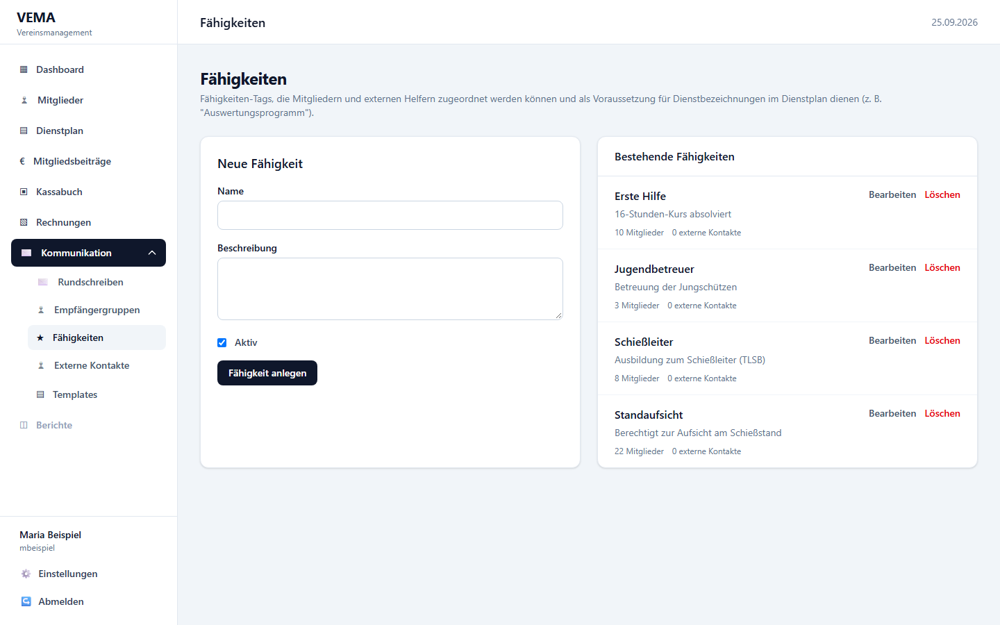

Fähigkeiten beschreiben Qualifikationen wie *Standaufsicht*, *Schießleiter* oder *Erste Hilfe*. Sie werden beim Mitglied (Anlegen/Bearbeiten) bzw. in der Helferverwaltung bei externen Helfern zugeordnet und im Dienstplan als **Pflicht-Fähigkeit** genutzt. Eine Fähigkeit kann nicht gelöscht werden, solange eine Dienstbezeichnung sie voraussetzt.

### 9.5 Templates (Textvorlagen)

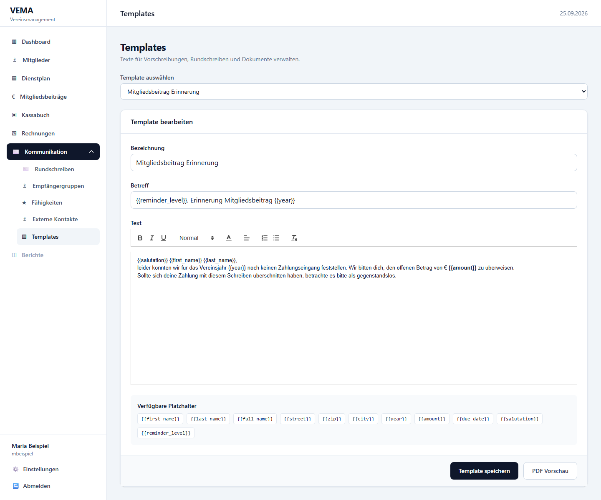

Hier bearbeiten Sie die Texte für Beitragsvorschreibungen, Erinnerungen, Rundschreiben und die Willkommens-E-Mails:

1. **Template auswählen**.
2. **Bezeichnung**, **Betreff** und **Text** anpassen (mit Fett, Kursiv, Listen usw.).
3. **Template speichern**; **PDF Vorschau** zeigt das Ergebnis auf dem Briefpapier.

Neue Vereine starten mit fertigen Vorlagen, die Sie an Ihren Verein anpassen können: **„Mitgliedsbeitragsvorschreibung“** und **„Mitgliedsbeitrag Erinnerung“** sowie die Willkommens-E-Mails **„Willkommen – neues Mitglied“** und **„Willkommen – neuer Funktionärszugang“**.

> **Willkommens-E-Mails:** Hier bearbeiten Sie nur Betreff und Begrüßungstext. Die Buttons (Mitgliederbereich, WhatsApp-Community bzw. Passwort festlegen und Anmeldung) fügt VEMA automatisch darunter an. Unter der Vorlage stehen die jeweils passenden Platzhalter, z. B. `{{club_name}}` für den Vereinsnamen oder `{{username}}` für den Benutzernamen; eine PDF-Vorschau gibt es für E-Mail-Vorlagen nicht. Sie erscheinen auch nicht als Vorlage für Rundschreiben.

**Verfügbare Platzhalter:**

| Platzhalter | wird ersetzt durch |
|---|---|
| `{{salutation}}` | Anrede passend zum Geschlecht („lieber“ / „liebe“ – bei Bedarf am Satzanfang selbst großschreiben) |
| `{{first_name}}`, `{{last_name}}`, `{{full_name}}` | Vorname, Nachname, vollständiger Name |
| `{{street}}`, `{{zip}}`, `{{city}}` | Adresse |
| `{{year}}` | Beitragsjahr |
| `{{amount}}` | Beitragsbetrag |
| `{{due_date}}` | Fälligkeitsdatum |
| `{{reminder_level}}` | Stufe der Erinnerung (1, 2, …) |

---

## 10. Kassabuch

*Nur für Kassier und Admin.*

### 10.1 Buchungen

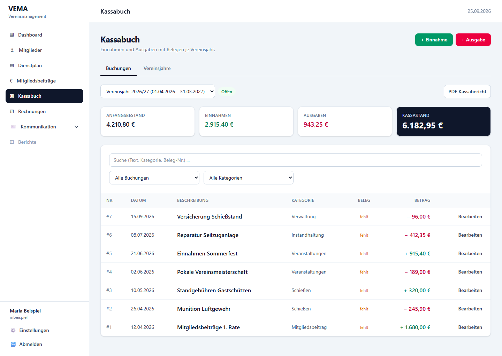

Das Kassabuch erfasst alle Einnahmen und Ausgaben je **Vereinsjahr** (von Jahreshauptversammlung zu Jahreshauptversammlung).

- Oben wählen Sie das **Vereinsjahr**; daneben steht, ob es *Offen* oder *Abgeschlossen* ist.
- Die Kacheln zeigen **Anfangsbestand**, **Einnahmen**, **Ausgaben** und den aktuellen **Kassastand**.
- **Suche** nach Text, Kategorie oder Belegnummer (z. B. `#12`), Filter nach Einnahmen/Ausgaben und Kategorie.
- In der Spalte **Beleg** sehen Sie sofort, wo ein Beleg **fehlt**.
- **PDF Kassabericht** erstellt den Bericht für die Kassaprüfung.

### 10.2 Buchung erfassen

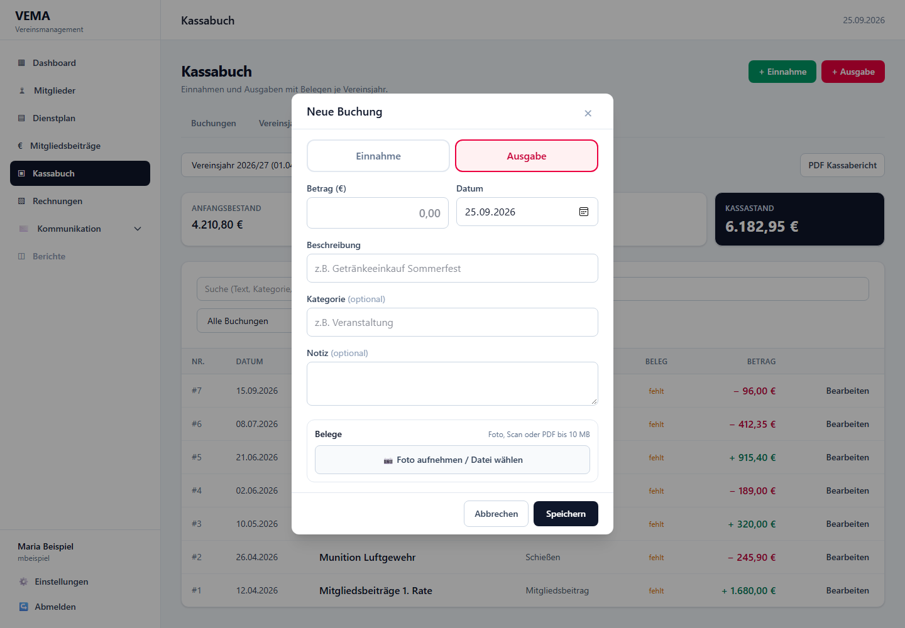

1. **+ Einnahme** oder **+ Ausgabe** klicken.
2. **Betrag**, **Datum** (muss im Vereinsjahr liegen) und **Beschreibung** eingeben; optional **Kategorie** (VEMA schlägt bereits verwendete vor) und **Notiz**.
3. Unter **Belege** mit **Foto aufnehmen / Datei wählen** einen oder mehrere Belege anhängen (PDF, JPG, PNG, WEBP, HEIC – je max. 10 MB). Am Smartphone können Sie die Rechnung direkt fotografieren.
4. **Speichern**.

Die **Belegnummer** wird automatisch fortlaufend vergeben. Über **Bearbeiten** lassen sich Buchungen ändern oder löschen, solange das Jahr offen ist.

> **Vereine auf vemat.at:** Das Anhängen von Belegen ist ab dem Paket „Basis“ enthalten.

### 10.3 Vereinsjahre

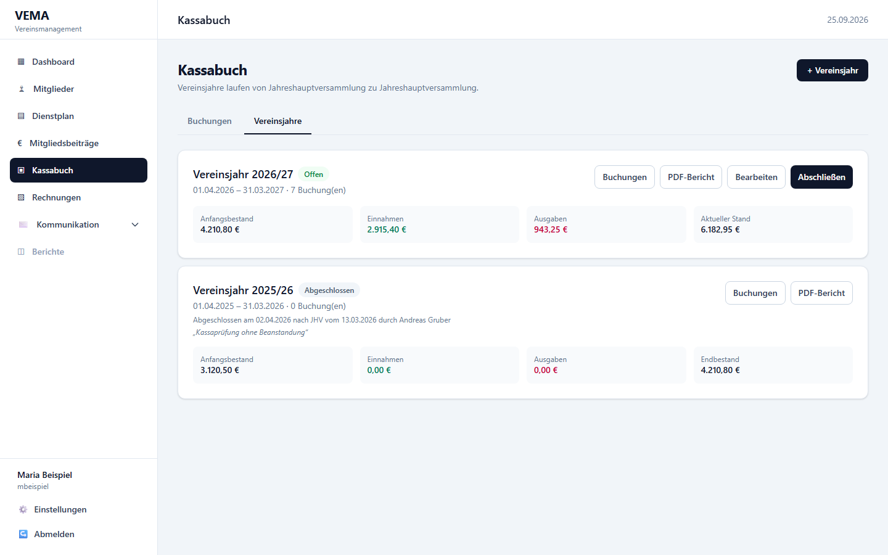

Unter dem Reiter **Vereinsjahre** sehen Sie alle Jahre mit ihren Summen.

- **+ Vereinsjahr** legt ein neues Jahr an. VEMA schlägt Beginn, Ende, Bezeichnung (z. B. „2026/27“) und den Anfangsbestand aus dem Vorjahr vor.
- **Bearbeiten** ändert Bezeichnung, Zeitraum und Anfangsbestand. Zeiträume dürfen sich nicht überschneiden.

### 10.4 Vereinsjahr abschließen

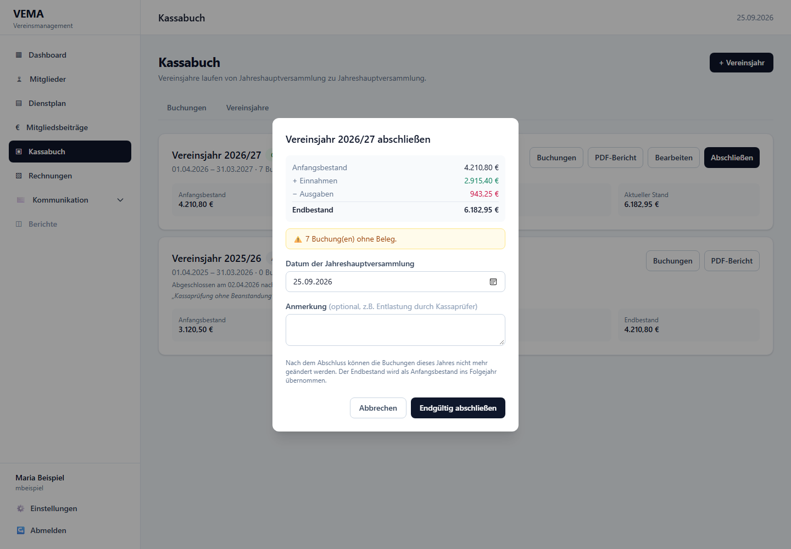

Nach der Jahreshauptversammlung wird das Jahr abgeschlossen:

1. Beim Vereinsjahr auf **Abschließen** klicken.
2. Die Übersicht zeigt Anfangsbestand, Einnahmen, Ausgaben und Endbestand sowie eine Warnung bei **Buchungen ohne Beleg**.
3. **Datum der Jahreshauptversammlung** und optional eine **Anmerkung** (z. B. „Entlastung durch die Kassaprüfer“) eintragen.
4. **Endgültig abschließen**.

> **Achtung:** Ein abgeschlossenes Jahr kann **nicht wieder geöffnet** werden. Der Endbestand wird automatisch als Anfangsbestand ins Folgejahr übernommen; gibt es noch kein Folgejahr, wird es automatisch angelegt.

---

## 11. Rechnungen

*Nur für Kassier und Admin.* Über die Reiter **Rechnungen | Empfänger | Artikel** erreichen Sie alle Bereiche.

### 11.1 Rechnungsübersicht

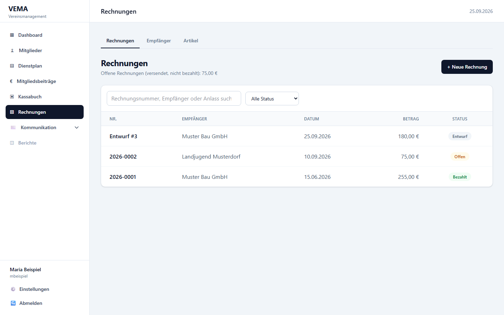

Die Liste zeigt alle Rechnungen mit Nummer, Empfänger, Datum, Betrag und Status (*Entwurf*, *Offen*, *Bezahlt*, *Storniert*). Oben sehen Sie die Summe aller **offenen Rechnungen**. Suche und Statusfilter helfen beim Finden.

### 11.2 Rechnung erstellen

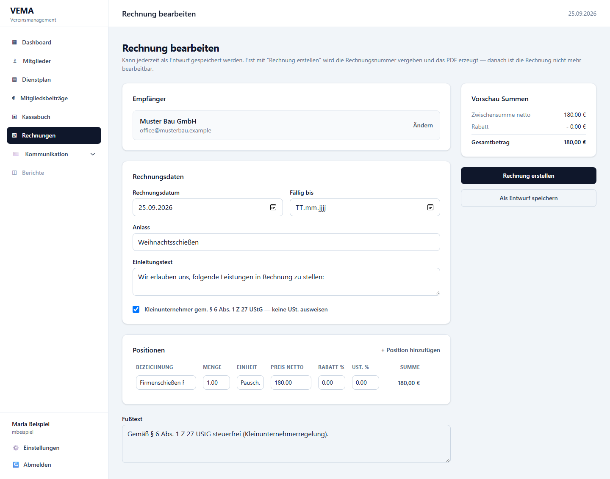

1. **+ Neue Rechnung** klicken.
2. **Empfänger** suchen und auswählen – oder über **+ Neuen Empfänger anlegen** direkt erfassen.
3. **Rechnungsdaten:** Rechnungsdatum, *Fällig bis*, Anlass und Einleitungstext. Das Häkchen **Kleinunternehmer** (keine USt.) ist gemäß Einstellungen vorbelegt.
4. **Positionen:** Bezeichnung, Menge, Einheit, Preis netto, Rabatt und USt. Beim Tippen werden passende **Artikel** vorgeschlagen, deren Preis, Einheit und Steuersatz automatisch übernommen werden. Mit **+ Position hinzufügen** weitere Zeilen ergänzen.
5. Rechts sehen Sie die **Vorschau der Summen**.
6. Speichern:
   - **Als Entwurf speichern** – jederzeit weiter bearbeitbar.
   - **Rechnung erstellen** – vergibt die **Rechnungsnummer** und erzeugt das **PDF**.

> **Wichtig:** Nach „Rechnung erstellen“ ist die Rechnung **nicht mehr änderbar**. Die Nummern werden fortlaufend vergeben – standardmäßig pro Jahr im Format 2026-0001, 2026-0002 … Den **Nummernkreis** (Format und nächste Nummer) kann der Admin unter **Einstellungen → Vereinseinstellungen** anpassen (Kapitel 12.1).

> **Tipp:** Neue Positionen, die noch keinem Artikel entsprechen, werden automatisch als Artikel angelegt – so bauen Sie Ihren Artikelstamm nebenbei auf.

### 11.3 Rechnung versenden und verwalten

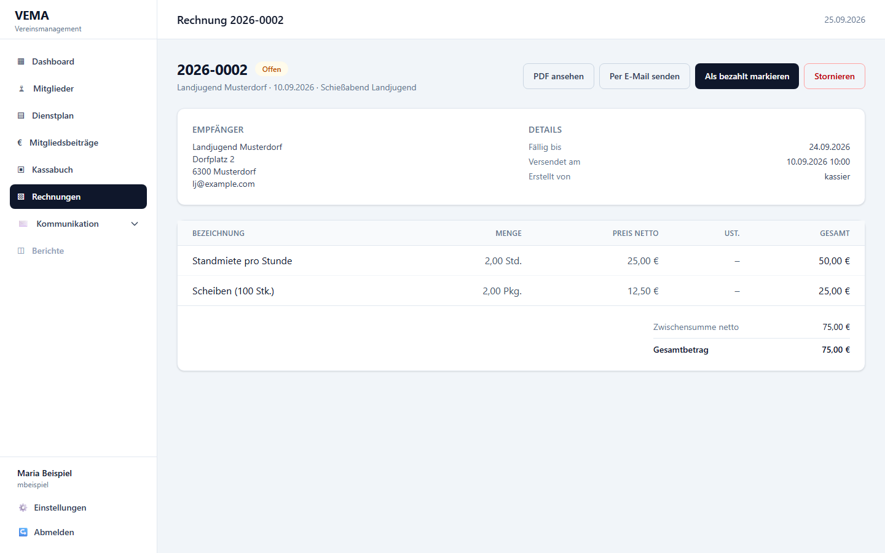

Auf der Detailseite einer erstellten Rechnung:

- **PDF ansehen** – die fertige Rechnung.
- **Per E-Mail senden** – schickt das PDF an die E-Mail-Adresse des Empfängers (auch mehrmals möglich).
- **Als bezahlt markieren** – nach Zahlungseingang.
- **Stornieren** – die Rechnung wird ungültig, bleibt aber zur Nachvollziehbarkeit erhalten.

Entwürfe haben stattdessen die Knöpfe **Bearbeiten** und **Rechnung erstellen**.

### 11.4 Empfänger und Artikel

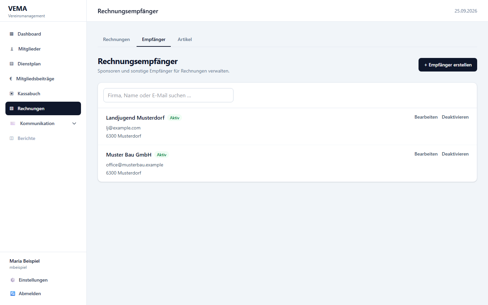

**Empfänger** sind Sponsoren, Firmen oder Vereine, an die Rechnungen gehen. Erforderlich ist eine Firma oder ein Nachname. Nicht mehr benötigte Empfänger werden **deaktiviert**.

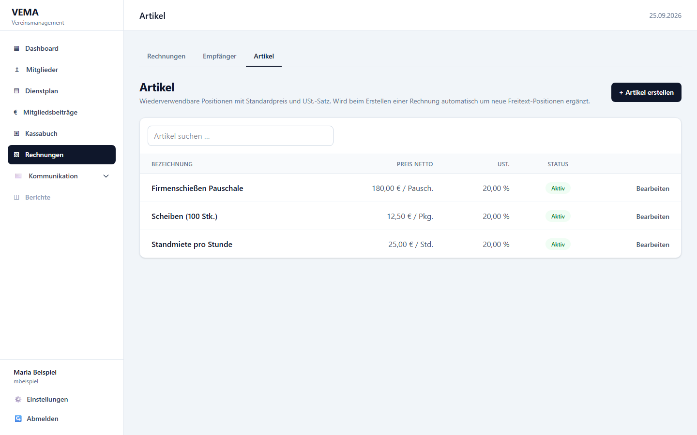

**Artikel** sind wiederkehrende Leistungen mit Bezeichnung, Einheit, Nettopreis und Steuersatz (z. B. „Standmiete pro Stunde“). Auch Artikel werden nicht gelöscht, sondern deaktiviert.

---

## 12. Administration

*Nur für Admins.* Über **Einstellungen** unten in der Seitenleiste erreichen Sie die Reiter **Vereinseinstellungen | Briefpapier & E-Mail | Benutzerverwaltung | Aktivitätsprotokoll**.

### 12.1 Vereinseinstellungen

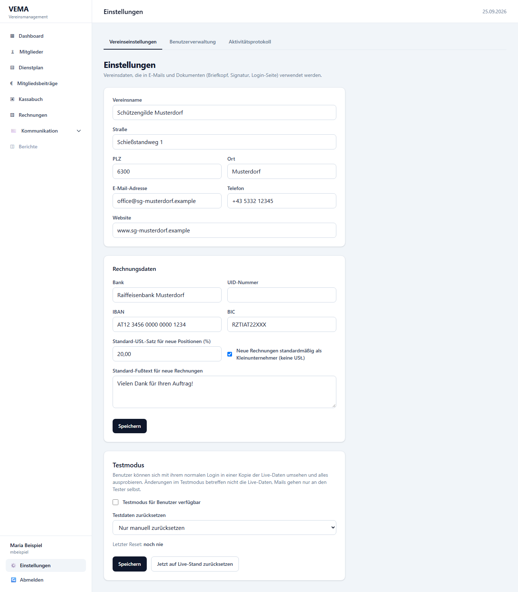

- **Vereinsdaten:** Name, Adresse, E-Mail, Telefon und Website. Diese erscheinen in E-Mails, auf dem Briefkopf und auf der Anmeldeseite.
- **WhatsApp-Community-Link:** Einladungslink zur WhatsApp-Community des Vereins (in WhatsApp: Community → Mitglieder einladen → Link, beginnt mit `https://chat.whatsapp.com/`). Er erscheint als Button in der Willkommens-E-Mail für neue Mitglieder. Mitglieder können damit selbst beitreten; je nach Community-Einstellung bestätigt ein Admin die Anfrage. Telefonnummern automatisch in die Community aufzunehmen ist mit WhatsApp nicht möglich.
- **Rechnungsdaten:** Bank, IBAN, BIC, UID-Nummer, Standard-Steuersatz, Kleinunternehmer-Voreinstellung und Standard-Fußtext für neue Rechnungen.
- **Nummernkreis** für Rechnungen – siehe unten.
- **Testmodus:** siehe 12.5.
- **Paket** (nur auf vemat.at): gebuchtes Paket, Ende der Testphase bzw. Lizenz, Anzahl aktiver Mitglieder und Vorstandszugänge im Verhältnis zum Paket sowie die enthaltenen Funktionen (Kapitel 15).

> **Hinweis:** Wird der **Standard-USt.-Satz auf 0 %** gesetzt, gilt 0 % für alle Rechnungspositionen – auch wenn beim Artikel ein anderer Satz hinterlegt ist.

**Nummernkreis der Rechnungen**

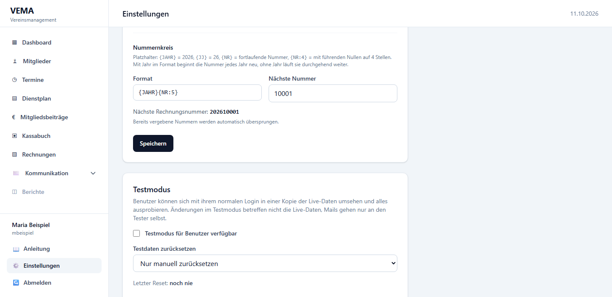

Unter **Rechnungsdaten → Nummernkreis** legen Sie fest, wie Rechnungsnummern aussehen:

- **Format** mit Platzhaltern:

  | Platzhalter | wird zu |
  |---|---|
  | `{JAHR}` | 2026 |
  | `{JJ}` | 26 |
  | `{NR}` | fortlaufende Nummer (1, 2, 3 …) |
  | `{NR:4}` | fortlaufende Nummer mit führenden Nullen auf 4 Stellen (0001, 0002 …) |

  Außer den Platzhaltern sind Buchstaben, Ziffern sowie `-` `_` `/` `.` erlaubt, z. B. `RE-{JJ}/{NR}`. Eine Rechnungsnummer darf höchstens 20 Zeichen lang sein.
- **Nächste Nummer:** mit welcher Zahl die nächste Rechnung beginnt.
- Darunter zeigt die **Vorschau**, wie die nächste Rechnungsnummer aussehen wird. Mit **Speichern** übernehmen.

Enthält das Format ein Jahr (`{JAHR}` oder `{JJ}`), beginnt die Nummer **jedes Jahr neu bei 1**. Ohne Jahr läuft sie **durchgehend** weiter. Der Standard ist `{JAHR}-{NR:4}` (2026-0001).

> **Beispiel – Umstieg unter dem Jahr:** Ein Verein hat bisher mit einem anderen Programm Rechnungen geschrieben und möchte in VEMA bei 202610001 weitermachen. Dazu Format `{JAHR}{NR:5}` und nächste Nummer `10001` eintragen – die Vorschau zeigt „202610001“.

> **Keine doppelten Nummern:** Ist eine Nummer bereits an eine Rechnung vergeben, überspringt VEMA sie automatisch. Ändern Sie die nächste Nummer trotzdem nur bewusst – Rechnungsnummern sollten lückenlos und fortlaufend sein.

### 12.2 Briefpapier & E-Mail

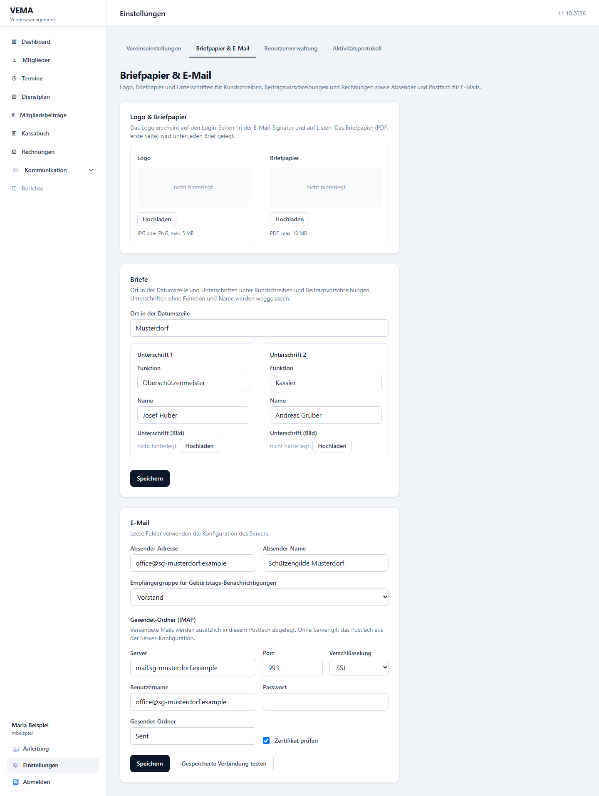

Hier legen Sie fest, wie Briefe und E-Mails des Vereins aussehen:

**Logo & Briefpapier**

- **Logo** (JPG oder PNG, max. 5 MB): erscheint auf den Anmeldeseiten, in der E-Mail-Signatur und auf Listen.
- **Briefpapier** (PDF, max. 10 MB): Die erste Seite wird unter jeden Brief gelegt – Rundschreiben, Beitragsvorschreibungen und Rechnungen. Ohne Briefpapier werden Briefe auf weißem Papier erstellt.
- **Hochladen** bzw. **Ersetzen** speichert die Datei sofort, **Entfernen** löscht sie (nach Rückfrage). Im Testmodus können Dateien nicht geändert werden.

**Briefe**

- **Ort in der Datumszeile:** z. B. „Musterort, am 26.09.2026“. Leer lassen, um den Ort aus den Vereinsdaten zu verwenden.
- **Unterschrift 1** und **Unterschrift 2:** jeweils **Funktion** (z. B. „Der Obmann“), **Name** (z. B. „MUSTER Max“) und optional ein Bild der **Unterschrift** (JPG/PNG). Unterschriften ohne Funktion und Name werden weggelassen.
- Mit **Speichern** übernehmen.

**E-Mail**

Leere Felder verwenden die Einstellungen des Servers.

- **Absender-Adresse** und **Absender-Name** (leer = Vereinsname).
- **Empfängergruppe für Geburtstags-Benachrichtigungen:** welche Empfängergruppe die automatischen Geburtstags-E-Mails erhält (Standard: „Vorstand“).
- **Gesendet-Ordner (IMAP):** Damit jede von VEMA versendete E-Mail auch im „Gesendet“-Ordner Ihres Vereinspostfachs landet, tragen Sie **Server**, **Port**, **Verschlüsselung**, **Benutzername**, **Passwort** und den Namen des **Gesendet-Ordners** ein (die Daten erhalten Sie von Ihrem E-Mail-Anbieter). Das Passwort wird verschlüsselt gespeichert; zum Behalten des gespeicherten Passworts das Feld leer lassen.
- **Speichern**, danach mit **Gespeicherte Verbindung testen** prüfen, ob der Zugang funktioniert und der Ordner gefunden wird.

> Alle Änderungen auf dieser Seite werden im Aktivitätsprotokoll festgehalten.

### 12.3 Benutzerverwaltung

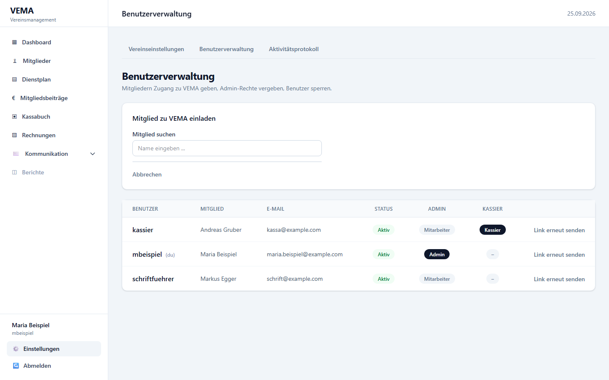

**Neuen Funktionär einladen:**

1. **+ Mitglied einladen** klicken.
2. Mitglied suchen und anklicken. Benutzername und E-Mail werden vorgeschlagen.
3. Optional **Admin-Rechte geben**.
4. **Benutzer anlegen & einladen** – die Person erhält eine Willkommens-E-Mail mit Benutzernamen, einem Link zum Festlegen des Passworts und einem Link zur Anmeldeseite (Text anpassbar unter Kommunikation → Templates, Vorlage „Willkommen – neuer Funktionärszugang“).

**In der Tabelle** können Sie per Klick:

- den **Status** zwischen *Aktiv* und *Gesperrt* umschalten (sich selbst kann man nicht sperren),
- die Rolle **Admin** / *Mitarbeiter* vergeben (der letzte Admin kann seine Rechte nicht verlieren),
- die Rolle **Kassier** vergeben oder entziehen,
- die Rolle **Homepage** vergeben oder entziehen (Kapitel 16.7),
- mit **Link erneut senden** eine neue Einladung bzw. einen Passwort-Link verschicken.

> **Vereine auf vemat.at:** Die Zahl der aktiven Vorstandszugänge hängt vom Paket ab. Ist sie erreicht, können keine weiteren Benutzer angelegt oder entsperrt werden – sperren Sie bei Bedarf einen nicht mehr benötigten Zugang.

### 12.4 Aktivitätsprotokoll

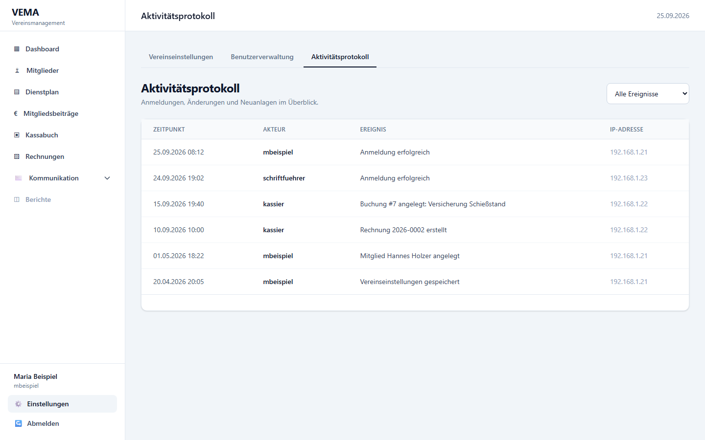

Das Protokoll zeigt, wer wann was getan hat – Anmeldungen, Änderungen an Mitgliedern, Einstellungen, Kassabuchungen, Rechnungen u. v. m. – mit Zeitpunkt, Akteur und IP-Adresse. Über das Auswahlfeld lässt sich nach Ereignisart filtern.

### 12.5 Testmodus

Im Testmodus können Funktionäre VEMA gefahrlos ausprobieren, z. B. zum Einschulen neuer Vorstandsmitglieder.

- Der Admin aktiviert in den Einstellungen **Testmodus für Benutzer verfügbar** und wählt, ob die Testdaten **jede Nacht automatisch** oder **nur manuell** auf den Live-Stand zurückgesetzt werden. **Jetzt auf Live-Stand zurücksetzen** kopiert die aktuellen Daten sofort in die Testumgebung.
- Funktionäre starten ihn über **Testmodus starten** in der Seitenleiste. Oben erscheint dann ein Banner „TESTMODUS – Änderungen betreffen nicht die Live-Daten“.
- Im Testmodus wird mit einer **Kopie** der Daten gearbeitet. **Alle E-Mails gehen ausschließlich an den Tester selbst** – Mitglieder bekommen nichts.
- Mit **Testmodus verlassen** kehren Sie zu den echten Daten zurück.

> **Tipp:** Offene Browser-Tabs aus dem jeweils anderen Modus zeigen nach dem Wechsel „Seite abgelaufen“ – das ist Absicht und verhindert, dass versehentlich in die falschen Daten geschrieben wird. Einfach die Seite neu laden.

---

## 13. Der Mitgliederbereich

Im Mitgliederbereich können sich **alle Mitglieder** selbst anmelden – ganz ohne Passwort.

### 13.1 Anmeldung per Login-Link

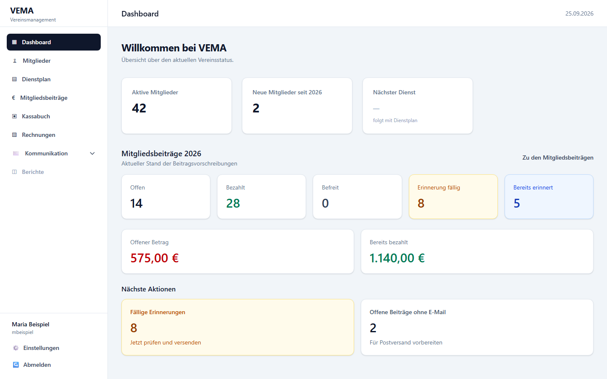

1. Die Anmeldeseite des Mitgliederbereichs öffnen (auf der normalen Anmeldeseite **Zum Mitglieder-Login**).
2. Die **E-Mail-Adresse** eingeben, die im Verein hinterlegt ist.
3. **Login-Link anfordern** klicken.
4. In der E-Mail auf den Link klicken – fertig.

> Der Link ist **30 Minuten gültig** und funktioniert nur **einmal**. Pro E-Mail-Adresse können innerhalb von 10 Minuten höchstens 3 Links angefordert werden. Kommt keine E-Mail an, bitte den Spam-Ordner prüfen – und beim Verein nachfragen, ob die richtige Adresse hinterlegt ist.

**Familien mit gemeinsamer E-Mail-Adresse:** Sind mehrere aktive Mitglieder mit derselben Adresse gespeichert, erscheint nach dem Login die Auswahl **Profil auswählen**. Über **Profil wechseln** kann jederzeit zwischen den Profilen gewechselt werden.

### 13.2 Mein Profil

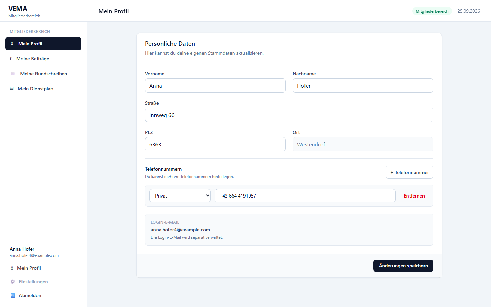

Ganz oben können Mitglieder unter **Profilbild** mit **Foto hochladen** bzw. **Foto ändern** ein eigenes Bild wählen und den Ausschnitt selbst festlegen (wie in Kapitel 5.3 beschrieben) oder es mit **Foto entfernen** löschen. Der Vorstand sieht das Bild auf der Mitgliedsseite.

Mitglieder können Vorname, Nachname, Straße, PLZ und ihre **Telefonnummern** selbst aktualisieren und mit **Änderungen speichern** sichern. Der Ort ergibt sich aus der PLZ. E-Mail-Adresse und Geburtsdatum können nur vom Verein geändert werden.

### 13.3 Meine Beiträge

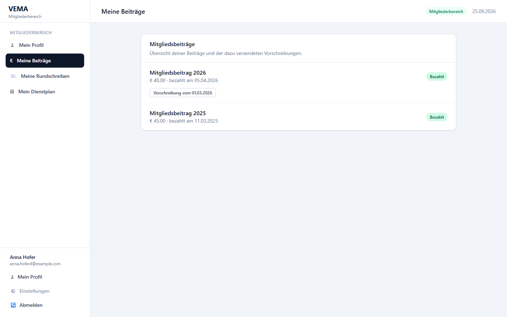

Übersicht aller Mitgliedsbeiträge mit Betrag, Zahlungsstatus und Fälligkeit. Versendete Vorschreibungen und Erinnerungen können direkt als PDF geöffnet werden.

### 13.4 Meine Rundschreiben

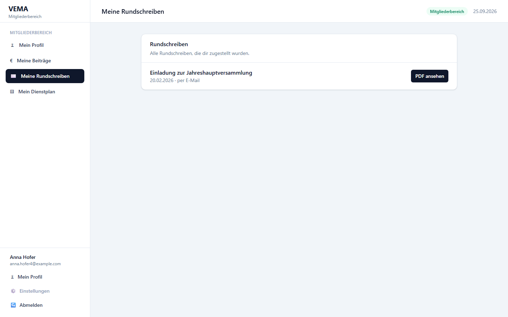

Alle Rundschreiben, die das Mitglied erhalten hat, als PDF – inklusive Anhängen.

### 13.5 Mein Dienstplan

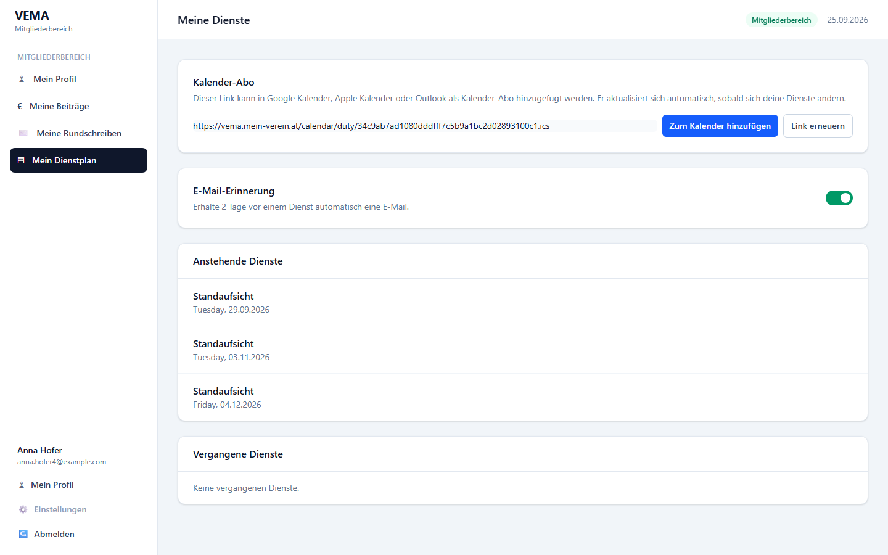

- **Anstehende** und **vergangene Dienste** auf einen Blick.
- **Kalender-Abo:** siehe 13.7.
- **E-Mail-Erinnerung:** Ist der Schalter aktiv (Standard), erhält das Mitglied **2 Tage vor jedem Dienst** eine Erinnerung per E-Mail.

### 13.6 Termine

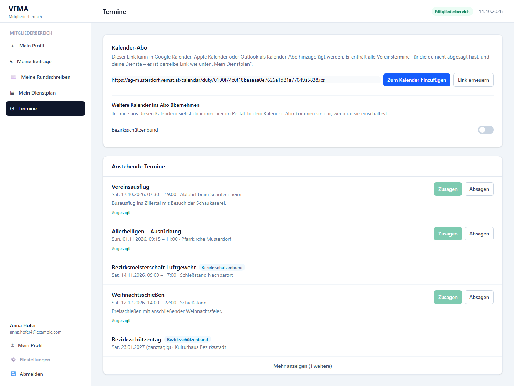

Unter **Termine** sehen Mitglieder die anstehenden Vereinstermine – zunächst die nächsten fünf, mit **Mehr anzeigen** weitere. Termine aus externen Kalendern tragen ein Etikett mit dem Namen des Kalenders (z. B. „Termine Landesverband“).

- Mit **Zusagen** bzw. **Absagen** melden sich Mitglieder zurück. Die gewählte Antwort steht beim Termin („Zugesagt“ / „Abgesagt“) und kann bis zum Termin jederzeit geändert werden.
- Bei reinen Informationsterminen gibt es keine Knöpfe.
- Termine, die der Verein nur für bestimmte Mitglieder freigegeben hat, sehen auch nur diese.

### 13.7 Kalender-Abo

Auf den Seiten **Mein Dienstplan** und **Termine** steht derselbe persönliche **Kalender-Abo-Link**. Mit **Zum Kalender hinzufügen** wird er in Google Kalender, Apple Kalender oder Outlook abonniert und aktualisiert sich danach automatisch.

Das Abo enthält:

- alle eigenen **Dienste**,
- alle **Vereinstermine**, die das Mitglied sehen darf – außer solchen, für die es **abgesagt** hat,
- Termine **externer Kalender** nur, wenn das Mitglied sie einschaltet: Auf der Seite **Termine** gibt es dafür unter **Weitere Kalender ins Abo übernehmen** pro Kalender einen Schalter (standardmäßig aus). Im Mitgliederbereich selbst werden diese Termine immer angezeigt.

**Link erneuern** macht den alten Link ungültig (z. B. wenn er versehentlich weitergegeben wurde). Danach muss der neue Link im Kalender neu abonniert werden.

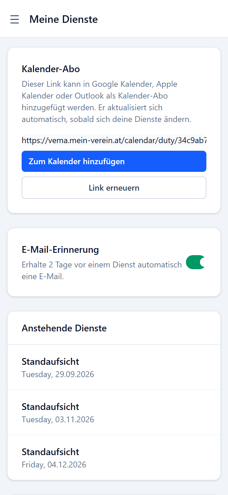

### 13.8 Meine Dokumente

Unter **Meine Dokumente** findet das Mitglied Unterlagen, die der Verein für es freigegeben hat – etwa die eigene Beitrittserklärung. Sie lassen sich **ansehen** (PDF und Bilder) und **herunterladen**. Beitragsschreiben und Rundschreiben stehen weiterhin unter **Meine Beiträge** bzw. **Meine Rundschreiben**.

---

## 14. Automatische Abläufe im Hintergrund

VEMA erledigt einige Aufgaben selbstständig:

| Was | Wann | Details |
|---|---|---|
| **Geburtstags-Erinnerung** | täglich 7:00 Uhr | Bei runden und halbrunden Geburtstagen aktiver Mitglieder erhält die eingestellte Empfängergruppe (Standard **„Vorstand“**) eine E-Mail – die Empfänger stehen im BCC. |
| **Monatliche Geburtstagsliste** | am 1. jedes Monats, 6:30 Uhr | PDF-Liste aller Geburtstage des Monats an dieselbe Gruppe, ebenfalls im BCC. |
| **Dienst-Erinnerung** | täglich 7:00 Uhr | Helfer mit Dienst in 2 Tagen erhalten eine E-Mail (sofern nicht abgeschaltet und E-Mail vorhanden). |
| **Externe Kalender abgleichen** | stündlich | Termine aller aktiven externen Kalender werden übernommen (Kapitel 7.4). |
| **Testdaten zurücksetzen** | nachts (Standard 3:00 Uhr) | nur wenn in den Einstellungen „Jede Nacht automatisch“ gewählt ist |
| **Hinweise zu Testphase und Lizenz** | täglich (nur vemat.at) | E-Mail an die Kontaktadresse des Vereins vor Ende der Testphase bzw. vor Ablauf der Lizenz (Kapitel 15.3) |

Alle von VEMA versendeten E-Mails werden zusätzlich im **„Gesendet“-Ordner** des Vereinspostfachs abgelegt, sodass der Schriftverkehr vollständig nachvollziehbar bleibt (Einrichtung siehe Kapitel 12.2).

---

## 15. VEMA auf vemat.at: Registrierung, Pakete und Testphase

Dieses Kapitel betrifft nur Vereine, die VEMA über die Plattform **vemat.at** nutzen. Preise, AGB und Datenschutzerklärung finden Sie auf **vemat.at**.

### 15.1 Verein registrieren

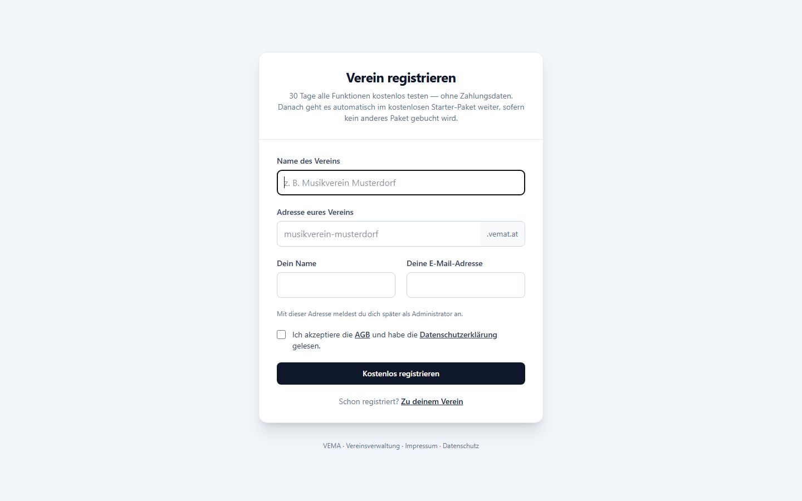

1. Auf **app.vemat.at/registrieren** (oder über **Kostenlos registrieren** auf vemat.at) das Formular ausfüllen:
   - **Name des Vereins**
   - **Adresse eures Vereins** – daraus wird die eigene Adresse, z. B. `musikverein-musterdorf.vemat.at`. VEMA schlägt sie aus dem Vereinsnamen vor. Erlaubt sind 3 bis 40 Zeichen: Kleinbuchstaben, Ziffern und Bindestriche (nicht am Anfang oder Ende).
   - **Dein Name** und **Deine E-Mail-Adresse** – mit dieser Adresse melden Sie sich später als Administrator an.
   - Häkchen bei den **AGB** und der **Datenschutzerklärung**.
2. **Kostenlos registrieren** klicken. Sie erhalten eine E-Mail „Registrierung bei VEMA bestätigen“.
3. Den Link in der E-Mail öffnen (gültig **72 Stunden**) und **Verein jetzt einrichten** klicken. Das dauert einen Moment.
4. Anschließend legen Sie direkt Ihr **Passwort** fest. Zusätzlich kommt eine Willkommens-E-Mail mit der Adresse des Vereins.

Danach melden Sie sich unter der Adresse Ihres Vereins mit Ihrer **E-Mail-Adresse als Benutzername** an. Vereinsname und E-Mail-Adresse sind in den Einstellungen bereits eingetragen; weitere Funktionäre laden Sie über die Benutzerverwaltung ein (Kapitel 12.3).

> Nicht bestätigte Registrierungen werden nach 72 Stunden gelöscht – die Adresse ist dann wieder frei. Kommt keine E-Mail an, bitte auch im Spam-Ordner nachsehen.

### 15.2 Pakete

Jedes Paket enthält alles aus den kleineren Paketen. **Mitglieder, Beiträge, Kassabuch und Rundschreiben** sind in jedem Paket enthalten.

| Paket | Aktive Mitglieder | Vorstandszugänge | zusätzlich enthalten |
|---|---|---|---|
| **Starter** (kostenlos) | bis 10 | 1 | – |
| **Basis** | bis 50 | 2 | Belegablage im Kassabuch, Eigene Vorlagen & Briefpapier |
| **Verein** | bis 150 | 3 | Dienstplan, Rechnungen, Empfängergruppen & externe Kontakte, Vereinstermine, Vereinshomepage mit News |
| **Verein Plus** | bis 500 | 10 | Mitgliederportal, Aktivitätsprotokoll, Testmodus |
| **Großverein / Verband** | unbegrenzt | unbegrenzt | alles (individuelles Angebot) |

Gezählt werden nur **aktive** Mitglieder und **nicht gesperrte** Vorstandszugänge.

**Was passiert, wenn etwas nicht im Paket enthalten ist?** Menüpunkte und Bereiche der Funktion werden ausgeblendet. Ruft jemand die Seite trotzdem auf, erscheint z. B. „„Dienstplan“ ist in eurem Paket „Basis“ nicht enthalten (ab Paket „Verein“).“ Mitglieder sehen im Mitgliederbereich eine entsprechende Hinweisseite. Ist eine Grenze erreicht, weist VEMA beim Anlegen darauf hin (Kapitel 5.2 und 12.3).

Welches Paket gebucht ist, was enthalten ist und wie viel davon genutzt wird, sehen Admins unter **Einstellungen → Vereinseinstellungen** im Kasten **Paket**. **Pakete ansehen** führt zur Preisübersicht.

### 15.3 Testphase und Lizenz

- Nach der Einrichtung können Sie **30 Tage lang alle Funktionen kostenlos testen** – ohne Zahlungsdaten. Dabei gelten mindestens die Grenzen von „Verein Plus“ (500 Mitglieder, 10 Vorstandszugänge).
- Admins sehen währenddessen oben einen Hinweis „Testphase mit allen Funktionen: noch … Tage (bis …), danach Paket …“.
- Eine Woche und einen Tag vor Ende sowie nach Ende der Testphase erhält die Kontakt-E-Mail-Adresse des Vereins eine Erinnerung.
- Nach der Testphase geht es im gebuchten Paket weiter – ohne Buchung im kostenlosen **Starter**-Paket. **Alle Daten bleiben erhalten**; Funktionen außerhalb des Pakets sind nur ausgeblendet und mit einem größeren Paket sofort wieder da.
- Bei gebuchten Paketen kommt 30 und 7 Tage vor Ablauf der Lizenz eine Erinnerung. Zum Verlängern einfach auf diese E-Mail antworten.
- Ist die Lizenz abgelaufen oder der Zugang gesperrt, zeigt die Adresse des Vereins nur noch einen entsprechenden Hinweis. Die Lizenz gilt bis einschließlich zum Ablaufdatum.

---

## 16. Vereinshomepage

*Nur für Admins und Benutzer mit der Rolle **Homepage**.* Bei Vereinen auf vemat.at ab Paket „Verein“.

VEMA erstellt aus Ihren Inhalten eine öffentliche Homepage für den Verein. Sie wählen eine von vier Vorlagen und schreiben News-Beiträge direkt in VEMA – ohne zusätzliches Programm. Alle Einstellungen finden Sie im Menü unter **Homepage**.

Die Homepage besteht aus diesen Seiten:

| Seite | Inhalt |
|---|---|
| **Start** | Überschrift, Begrüßungstext und Titelbild, darunter die neuesten Beiträge (Vorlage „Verein“ zusätzlich Ankündigung, Kacheln und Kennzahlen, Kapitel 16.5) |
| **News** | alle veröffentlichten Beiträge, neueste zuerst, mit Filter nach Jahr |
| **Über uns** | freier Text und Abschnitte (nur sichtbar, wenn etwas eingetragen ist, Kapitel 16.4) |
| **Vorstand** | automatisch aus den aktuellen Vorstandsfunktionen der Mitglieder (Kapitel 5.5) |
| **Kontakt** | Anschrift, E-Mail, Telefon und WhatsApp-Community aus den Vereinseinstellungen |
| **Eigene Seiten** | z. B. Impressum, Datenschutz, Training, „Mitglied werden“ – auch aus Abschnitten aufgebaut |

### 16.1 Gestaltung und Einstellungen

Unter **Homepage → Gestaltung**:

1. **Vorlage** wählen:
   - **Klassisch** – ruhig und seriös, Serifenschrift, News als Liste.
   - **Modern** – hell und luftig, großes Titelbild, News als Karten.
   - **Sportlich** – kräftig, dunkler Kopfbereich, große News-Kacheln.
   - **Verein** – frisch und übersichtlich: Titelbild mit Farbverlauf, Ankündigung, Info-Kacheln, News-Karten, Kennzahlen, farbige Seitenköpfe und eine ausführliche Fußzeile. Die zusätzlichen Inhalte pflegen Sie unter **Homepage → Inhalte** (Kapitel 16.5).
2. **Hauptfarbe** und **Akzentfarbe** festlegen, z. B. die Vereinsfarben. Die Akzentfarbe hebt Datum, aktiven Menüpunkt und Seitenköpfe hervor (Vorlage „Verein“). Die Vorschaubilder der Vorlagen zeigen beide sofort.
3. Unter **Startseite** **Überschrift**, **Begrüßungstext** und **Titelbild** eintragen. Das Titelbild wird beim Hochladen gespeichert.
4. Unter **Seiten & Daten** festlegen, ob **Kontaktseite** und **Vorstand** erscheinen und ob die Vorstandsseite **Profilbilder** zeigt.
5. Den Text für **Über uns** schreiben.
6. **Einstellungen speichern**.

Das Vereinslogo kommt automatisch aus den Vereinseinstellungen (Kapitel 12).

> **Datenschutz:** Auf der Vorstandsseite stehen nur Name und Funktion. Profilbilder erscheinen nur, wenn Sie **Mit Profilbildern** einschalten. Tun Sie das erst, wenn alle Vorstandsmitglieder der Veröffentlichung ihres Fotos zugestimmt haben.

**Veröffentlichen:** Solange **Homepage ist öffentlich erreichbar** ausgeschaltet ist, sehen nur angemeldete Homepage-Verantwortliche die Seiten. Oben erscheint dann ein gelber Hinweis „Vorschau“. Über **Homepage ansehen** öffnen Sie die Homepage in einem neuen Fenster.

*[Abbildung folgt: Homepage → Gestaltung mit den vier Vorlagen]*

### 16.2 Beiträge schreiben

Unter **Homepage → Beiträge** sehen Sie alle Beiträge mit Status, Datum und Anzahl der Bilder. Mit den Filtern **Veröffentlicht** und **Entwürfe** grenzen Sie die Liste ein.

1. **Neuer Beitrag** klicken.
2. **Titel** eingeben. Die **Adresse** (z. B. `/news/sommerfest-2026`) schlägt VEMA vor; Sie können sie ändern.
3. Optional einen **Kurztext** eintragen. Er erscheint in der Übersicht und in Suchmaschinen. Ohne Kurztext nimmt VEMA den Anfang des Beitrags.
4. Den **Text** schreiben: Überschriften, fett/kursiv, Links, Zitate und Aufzählungen.
5. Unter **Bildergalerie** **Bilder auswählen** (JPG, PNG oder WebP, je max. 10 MB, mehrere auf einmal).
6. Optional unter **Downloads** **PDF auswählen**, z. B. eine Ergebnisliste (je max. 20 MB). Die Bezeichnung können Sie ändern.
7. **Status** wählen und **Beitrag anlegen** bzw. **Änderungen speichern**.

**Status und Veröffentlichungsdatum:**

- **Entwurf** – nur in VEMA sichtbar.
- **Veröffentlicht** ohne Datum – sofort auf der Homepage.
- **Veröffentlicht** mit Datum in der Zukunft – in der Liste als **Geplant** markiert und ab diesem Zeitpunkt automatisch sichtbar.

**Vorschau** zeigt den Beitrag im Design der Homepage, auch als Entwurf.

**Bildergalerie:** Das erste Bild ist das **Titelbild** des Beitrags. Mit **↑ nach vorne** und **↓** ändern Sie die Reihenfolge, mit **Löschen** entfernen Sie ein Bild. Bildunterschriften werden mit **Änderungen speichern** übernommen. Bei einem neuen Beitrag werden die ausgewählten Bilder beim Anlegen gespeichert.

> **Hinweis:** Bilder werden beim Hochladen automatisch verkleinert und neu gespeichert. Dabei gehen versteckte Metadaten wie der Aufnahmeort (GPS) verloren – gewollt, aus Datenschutzgründen.

*[Abbildung folgt: Beitrag bearbeiten mit Bildergalerie]*

### 16.3 Eigene Seiten

Unter **Homepage → Seiten** legen Sie weitere Seiten an:

1. **Titel** eingeben. Die **Adresse** wird vorgeschlagen.
2. Optional eine **Überschrift im Seitenkopf** eintragen.
3. **Inhalt** schreiben – oder leer lassen und die Seite aus Abschnitten aufbauen (Kapitel 16.4).
4. **Reihenfolge** festlegen (kleine Zahlen zuerst).
5. **Im Menü anzeigen**: Ohne Häkchen erscheint die Seite nur als Link in der Fußzeile, z. B. das Impressum.
6. **Veröffentlicht** anhaken und **Seite anlegen**.

Die Adressen der festen Seiten (z. B. `news`, `vorstand`, `kontakt`) sind reserviert.

**Überschrift im Seitenkopf:** Bei der Vorlage „Verein“ steht über jeder Seite ein farbiger Kopf. Ohne Eintrag zeigt er den Titel, mit Eintrag steht der Titel klein darüber – z. B. Titel „Training“, Überschrift „Jeden Montag ab 18 Uhr“.

> **Hinweis:** Eine Homepage braucht in Österreich ein **Impressum** (Offenlegung nach Mediengesetz) und meist eine **Datenschutzerklärung**. Legen Sie beides als eigene Seiten an.

### 16.4 Seiten aus Abschnitten aufbauen

Eigene Seiten und „Über uns“ lassen sich aus **Abschnitten** zusammensetzen – wie mit einem Baukasten. Unter **Homepage → Seiten** klicken Sie bei einer Seite auf **Abschnitte**, für „Über uns“ auf **Abschnitte** in der grauen Zeile ganz oben.

1. Links unter **Abschnitt hinzufügen** den passenden Baustein wählen.
2. Rechts die Inhalte eintragen und **Abschnitt speichern**.
3. Mit **↑** und **↓** die Reihenfolge ändern, mit **Löschen** entfernen.

| Baustein | Wofür |
|---|---|
| **Text** | Überschrift und formatierter Text |
| **Text mit Bild** | Text neben einem Bild; das Bild steht wahlweise links oder rechts |
| **Zahlen-Kacheln** | bis zu vier Kacheln mit großer Zahl, Titel und Text, z. B. „8 – Elektronische Stände“ |
| **Text mit Info-Box** | Text mit hervorgehobener Box, z. B. Mitgliedsbeitrag „€ 40,– pro Saison“ mit Button zur Beitrittserklärung. Nummerierte Listen im Text erscheinen als Schritte mit Kreis-Nummern |
| **Bilderpaar** | zwei Bilder nebeneinander mit Bildunterschrift |
| **Aufruf mit Button** | kurzer Text mit Button, z. B. „Zum Mitgliederbereich“ |
| **Vorstand** | Tabelle „Funktion – Namen“, automatisch aus den aktuellen Vorstandsfunktionen (Kapitel 5.5) |

**Buttons** führen zu einem hochgeladenen **PDF**, zum **Mitgliederbereich** von VEMA oder zu einem **Link**. Links auf eigene Seiten der Homepage beginnen mit „/“, z. B. `/kontakt`.

**Grauer Hintergrund:** Damit heben sich aufeinanderfolgende Abschnitte voneinander ab (am besten abwechselnd setzen).

Der Inhalt einer Seite (bzw. der Text „Über uns“ unter **Gestaltung**) steht über den Abschnitten. Er kann auch leer bleiben.

*[Abbildung folgt: Seitenabschnitte bearbeiten]*

### 16.5 Inhalte der Vorlage „Verein“

Unter **Homepage → Inhalte** pflegen Sie die zusätzlichen Elemente der Vorlage „Verein“ (bei anderen Vorlagen bleiben sie unsichtbar):

- **Titelbereich:** eine Zeile über der Überschrift (z. B. „Sportschießen in Angerberg seit 1991“) und ein zweiter Button (z. B. „Probetraining“ → `/training`). Ohne Eintrag führt der zweite Button zur Kontaktseite.
- **Ankündigung:** großes Banner unter dem Titelbereich mit Kennzeichnung (z. B. „Einladung“), Titel, Text, Bild und Button. Ist ein PDF hochgeladen, öffnet der Button das PDF, sonst den eingetragenen Link. Bild und PDF werden sofort gespeichert.
- **Kacheln:** bis zu drei Kacheln mit kleiner Zeile, Titel, Text und Link. Sind alle leer, erscheinen automatisch Kacheln zu den Seiten im Menü.
- **Kennzahlen:** dunkle Leiste am Ende der Startseite mit bis zu vier Zahlen, z. B. „1991 – gegründet“.
- **Überschriften der Seitenköpfe** für News, Über uns, Vorstand und Kontakt sowie die **Bezeichnung der News im Menü** (z. B. „Aktuelles“).
- **Kontakt & Fußzeile:** ein Text auf der Kontaktseite, eine **Info-Spalte** (z. B. „Training – Jeden Montag ab 18:00 Uhr“; erscheint in der Fußzeile und als Karte auf der Kontaktseite) und der Link **Mitgliederbereich** in der Fußzeile.

Alle Änderungen mit **Inhalte speichern** übernehmen.

> **Tipp:** Soll der Vorstand wie auf vielen Vereinsseiten unter „Über uns“ stehen, schalten Sie unter **Gestaltung** die eigene Vorstandsseite aus und fügen bei „Über uns“ den Abschnitt **Vorstand** hinzu.

### 16.6 Eigene Domain

Die Homepage ist zunächst unter der Adresse von VEMA mit `/site` erreichbar, z. B. `https://vema.mein-verein.at/site`. Damit sie unter einer eigenen Domain wie `www.mein-verein.at` erscheint:

- **Eigene Installation:** Die Domain unter **Homepage → Gestaltung → Eigene Domain** eintragen (ohne `https://` und ohne `www.` – beide Varianten funktionieren). Die Domain muss per DNS auf den VEMA-Server zeigen und dort im Webserver samt SSL-Zertifikat eingerichtet sein.
- **Vereine auf vemat.at:** Teilen Sie dem Support Ihre Wunschdomain mit. Nach der Einrichtung steht sie unter **Eigene Domain**.

Unter der eigenen Domain ist **nur die Homepage** erreichbar – Anmeldung und Verwaltung laufen weiter über die bisherige VEMA-Adresse.

### 16.7 Berechtigung „Homepage“

Damit z. B. ein Pressewart Beiträge schreiben kann, ohne Admin zu sein, vergibt ein Admin in der **Benutzerverwaltung** die Rolle **Homepage** (Kapitel 12.3). Wer diese Rolle hat, darf Beiträge, Seiten, Inhalte und Gestaltung bearbeiten, aber keine anderen Admin-Bereiche öffnen.

Alle Änderungen an der Homepage stehen im Aktivitätsprotokoll (Kapitel 12.4).

---

## 17. Häufige Fragen und Tipps

**Ich sehe den Menüpunkt „Kassabuch“ oder „Rechnungen“ nicht.**
Diese Bereiche sind Kassier und Admin vorbehalten. Wenden Sie sich an einen Admin. Bei Vereinen auf vemat.at kann ein Menüpunkt außerdem fehlen, weil die Funktion nicht im gebuchten Paket enthalten ist (Kapitel 15.2).

**Ein neues Mitglied hat keinen Beitrag im laufenden Jahr.**
Beiträge werden automatisch für alle *offenen* Beitragsjahre ab dem Eintrittsjahr angelegt. Prüfen Sie Eintrittsdatum und ob das Beitragsjahr abgeschlossen ist.

**Bei einem Mitglied kann keine Erinnerung verschickt werden.**
Voraussetzungen: Beitrag offen, Vorschreibung versendet, Fälligkeit beim Beitragsjahr eingetragen, Frist abgelaufen und Maximum nicht erreicht. Die Spalte *Erinnerung* zeigt den Grund (z. B. „Vorschreibung fehlt“ oder „ab 11.10.2026“).

**Warum wird ein Helfer im Dienstplan nicht angeboten?**
Mögliche Gründe: nicht in der Helferliste dieses Plans, an diesem Wochentag nicht verfügbar, abwesend, fehlende Pflicht-Fähigkeit oder am selben Tag bereits für einen anderen Dienst eingeteilt.

**Ich habe versehentlich „Automatisch einteilen“ geklickt.**
Die Einteilung wurde neu erstellt. Einzelne Änderungen können Sie manuell in der Terminliste vornehmen. Nutzen Sie vorher am besten **PDF exportieren**, wenn Sie einen bestehenden Stand sichern möchten.

**Ein Mitglied sieht einen Termin nicht.**
Prüfen Sie beim Termin, ob unter **Sichtbar für** Mitglieder ausgewählt sind – dann sehen nur diese ihn. Termine externer Kalender sind ausgeblendet, wenn der Kalender auf inaktiv gestellt ist. Im Kalender-Abo fehlen außerdem Termine, für die das Mitglied abgesagt hat, und Termine externer Kalender, die es nicht eingeschaltet hat.

**Ich kann einen Termin nicht bearbeiten oder löschen.**
Er stammt aus einem externen Kalender (erkennbar am farbigen Etikett). Ändern Sie ihn im Ursprungskalender – VEMA übernimmt die Änderung beim nächsten Abgleich, spätestens nach einer Stunde.

**Ein externer Kalender wird nicht aktualisiert.**
Unter dem Kalender steht in Rot der Grund, z. B. dass der Server nicht erreichbar ist oder der Link keinen Kalender liefert. Prüfen Sie den Link (öffnet er im Browser eine .ics-Datei?) und klicken Sie dann **Jetzt synchronisieren**.

**Wir wechseln unter dem Jahr zu VEMA – wie geht der Rechnungsnummernkreis weiter?**
Unter **Einstellungen → Vereinseinstellungen → Nummernkreis** Format und nächste Nummer passend zu Ihren bisherigen Rechnungen einstellen (Beispiel in Kapitel 12.1).

**Kann ich ein abgeschlossenes Kassajahr korrigieren?**
Nein – der Abschluss ist endgültig. Korrekturen werden als neue Buchung im Folgejahr erfasst.

**Kann ich eine erstellte Rechnung ändern?**
Nein. Stornieren Sie die Rechnung und erstellen Sie eine neue.

**Wo lege ich die unterschriebene Beitrittserklärung ab?**
Auf der Mitgliedsseite im Kasten **Dateien**: Datei hineinziehen, Kategorie „Beitrittserklärung“ eintragen und speichern (Kapitel 5.8). Mit einem Handy-Foto geht das auch direkt unterwegs.

**Ein Mitglied findet ein Dokument nicht im Mitgliederbereich.**
Dokumente sind standardmäßig nur für den Vorstand sichtbar. Öffnen Sie beim Dokument **Bearbeiten** und haken Sie **Im Mitgliederbereich für das Mitglied sichtbar** an.

**Eine Datei lässt sich nicht hochladen.**
Erlaubt sind PDF, Bilder, Word-, Excel- und Textdateien bis 10 MB. Große Scans am besten als PDF mit geringerer Auflösung speichern oder Fotos verkleinern.

**Wie probiere ich etwas aus, ohne echte Daten zu verändern?**
Nutzen Sie den **Testmodus** (Kapitel 12.5) – dort gehen alle E-Mails nur an Sie selbst.

**Meine Änderungen erscheinen nicht.**
Laden Sie die Seite neu (Taste F5). Wenn Sie längere Zeit inaktiv waren, müssen Sie sich eventuell neu anmelden.

---

*VEMA – Vereinsmanagement · Benutzerhandbuch*
